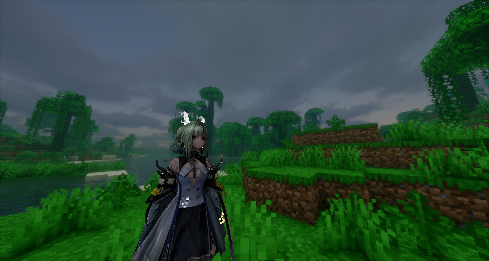
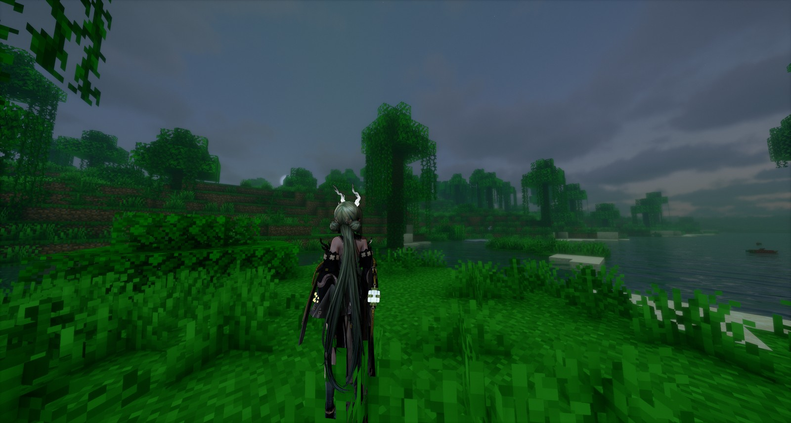
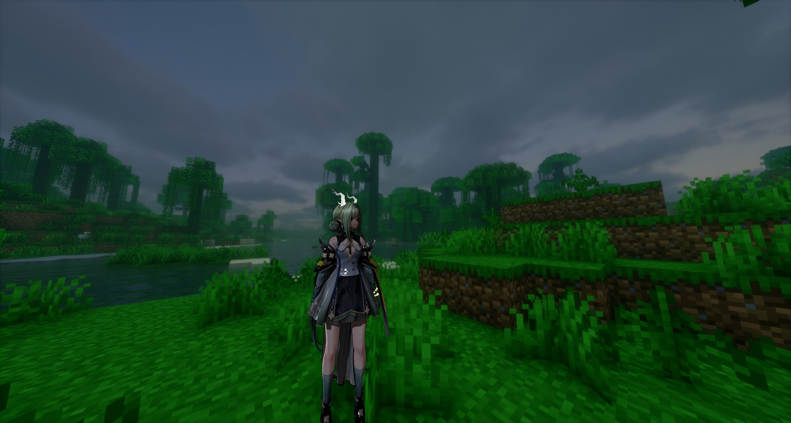
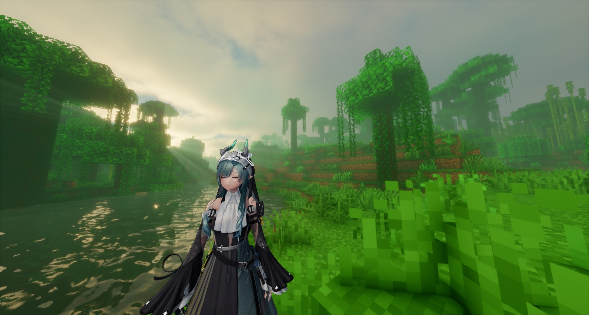
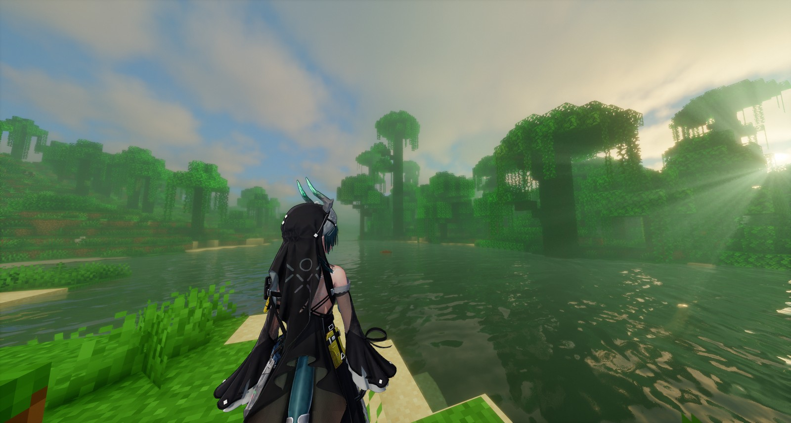

# YSM-3.0 3D Model Fork

[YesSteveModel](https://github.com/Els-y/YesSteveModel) 3.0 的一个 3D 模型 fork：在 YSM 3.0 上加入 VRM / GLB 人形模型导入、卡通渲染、程序化动作、手持物品与枪械适配、按模型形状的碰撞箱，以及服务端模型保护。

**本仓库提供源码、通用步态数据和游戏内截图。不包含截图中的角色模型或贴图文件，模型需自备。**

## 目录

| 目录 | 内容 | 许可 |
|---|---|---|
| `src/yesstevemodel` | YSM 3.0 Java 源码 fork：人形模型导入、动作、手持物品、表情 | Apache-2.0（见目录内 LICENSE / NOTICE） |
| `src/yesstevemodel-native` | YSM 原生库 fork：几何 LOD、弹簧骨骼 LOD | Apache-2.0 |
| `src/ysm-patch` | 打在 YSM 3.0-dev jar 上的补丁类和构建脚本 `build_jar.sh` | Apache-2.0 |
| `src/motion` | 步态动作工具：把自备的挂点动作转成导入器用的步态数据，导入时按 IK 套到每个模型的骨架上（格式见目录内 README） | Apache-2.0 |
| `src/render-npr` | 客户端卡通渲染模组，在光影包之后绘制角色；`config-default/` 为默认配置 | Apache-2.0 |
| `src/fitbox` | 按模型实际形状计算碰撞箱和视角高度，支持趴下、潜行、游泳 | Apache-2.0 |
| `src/model-guard` | 服务端模型加密与归属保护 | Apache-2.0 |
| `src/bfm-forge-port` | Battlefield Movement 的 Forge 1.20.1 移植（趴下、滑铲等），适配 YSM 模型 | MIT（见目录内 LICENSE） |

## 运行环境

- Minecraft 1.20.1，Forge 47.4.x
- 渲染模组需要 Oculus 1.6 及以上，可配合光影包使用
- TACZ 1.2.0 可选：枪械握把和第一人称手部适配

## 构建

- Java 模组：各目录下的 `build.sh`（JDK 17）。
- YSM jar：`src/ysm-patch/build_jar.sh <v18 jar> <v11 jar> <libraries 目录> <--bundled | anchors.json | -> <输出 jar>`。需要 YSM 3.0-dev 原版 jar，以及由 `src/yesstevemodel-native` 编译出的原生库（Windows `ysm-lod.dll`、Linux `libysm-lod-linux.so`）。第 4 个参数用 `--bundled` 打包仓库自带的通用步态，用 `anchors.json` 指定自备数据，或用 `-` 保留程序生成的步态。Java 工程的 Gradle 构建也会打包自带的通用步态。
- 原生库：CMake + Conan，见 `src/yesstevemodel-native` 内说明。

## 使用

1. 把构建出的 jar 放进 `mods/`（YSM jar 服务端和客户端都要；渲染模组只放客户端）。
2. 人形模型（VRM 0.x / 1.0、GLB）放进 YSM 的自定义模型目录 `ysm/custom/<模型名>/`，在 YSM 模型列表里选用。
3. 渲染参数在 `config/endfield_npr.properties`，默认值见 `src/render-npr/config-default/`；大部分参数修改后即时生效。

## 游戏内截图

以下是游戏内效果截图。**图中角色的模型与贴图文件不包含在仓库或构建中。**

## 声明

仅供学习和技术交流。截图仅用于展示效果，仓库不附角色模型或贴图文件。通用步态的数据来源见 [步态说明](src/motion/README.md)；如认为内容侵犯了您的权益，请提 issue，确认后会立即删除。
