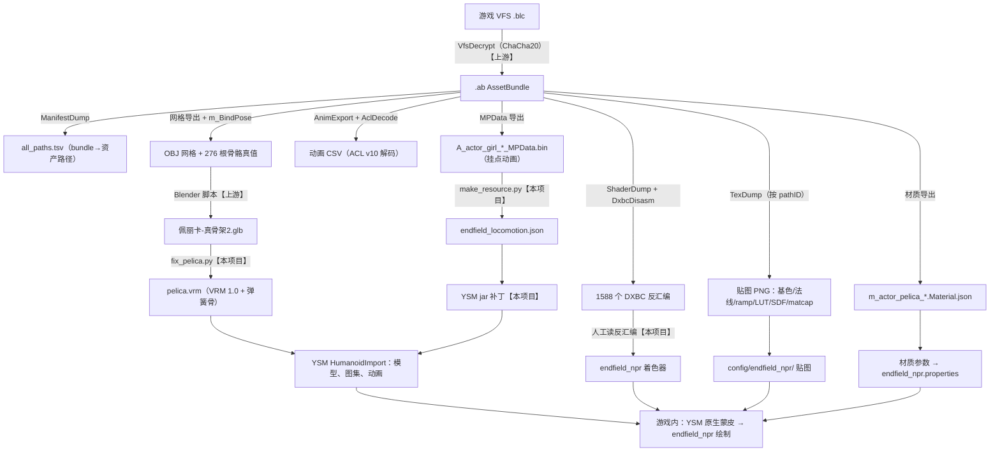

# 佩丽卡 → YesSteveModel：资源获取、转换、动作与渲染全流程技术文档

版本：2026-11-17（最终整合版）。对应交付包 `佩丽卡-YSM完整交付-20261117.zip`：YSM jar 缓存版本 13，渲染模组 endfield_npr 0.4.0。

**来源标注**：每一步都写明是谁做的。

| 标注 | 含义 |
|---|---|
| 【上游】 | 你方的解包工具链和交接包完成，我们没有重新执行，只核对了产物 |
| 【本项目】 | 我们写的代码 |
| 【调参】 | 资产里没有真值，按参考截图或实测数据定的 |
| 【未进游戏】 | 只做过离线检查，需要你在游戏里验证 |

---

## 0. 数据流总览



---

## 1. 从 .blc / .ab 到原始资源【上游】

依据 `~/ysm/pelica/06-文档/提取工具说明.md`、`给Claude的交接说明.md`、`~/ysm/sdf/README-SDF贴图.md`。工具是 C#，基于 AnimeStudio（终末地专用 AssetBundle 库）。

| 步骤 | 工具 | 输入 → 输出 | 要点 |
|---|---|---|---|
| 1 解密 | `VfsDecrypt` | `StreamingAssets/VFS/<HASH>/<HASH>.blc` → `.ab` | ChaCha20 |
| 2 清单 | `ManifestDump` | 全部 `.ab` → `all_paths.tsv` | 记录 bundle 到资产路径的映射，后续都靠它 |
| 3 模型 | 网格导出 | `assets/beyond/arts/entity/actor/girl/pelica/models/` → OBJ + Mesh.json | 部件分离，每块只蒙皮自己那片 |
| 4 骨架 | `extract_real_skeleton.py` | `m_BindPose` → `real-skeleton.json`（276 根） | 必须从 bindpose 读，`rest = inv(bind)`；拟合会错 27% |
| 5 贴图 | `TexDump` | Texture2D → PNG | 按材质贴图槽的 pathID 反查，不按文件名猜 |
| 6 公共贴图 | `TexDump`（按 pathID） | `actor/common/textures/` → SDF、SDF 遮罩、高光图、表情图集、matcap | 不在佩丽卡自己的目录。佩丽卡用 `female_face_01` |
| 7 材质 | 材质导出 | → `m_actor_pelica_*.mat.Material.json` | 第 6 节的逐材质参数取自这里 |
| 8 动画 | `AnimExport` + `AclDecode` | clip → CSV（每帧每骨局部 TRS，60 fps） | 佩丽卡的 3 个片段没有盆骨、脊柱、四肢主骨。面部骨也是恒定值，没有表情曲线 |
| 9 挂点动画 | MPData 导出 | `A_actor_girl_{idle,walk,run,sprint}_loop_MPData.bin` | 烘焙的 GPU 挂点，不是骨骼，见 3.1 |
| 10 Shader | `ShaderDump` + `DxbcDisasm` | Unity shader 容器 → 530 个 DXBC → 1588 个 `.asm` | DXBC 缺 `RDEF`，只能读反汇编 |

**组装 GLB**（`~/ysm/pelica/05-脚本/`，Blender 5.3）：
- `glb_from_raw_obj.py` 转 OBJ。UV 要做 `v → 1−v`，有一个旧脚本漏了这步。
- `build_rigged_from_bindpose.py` 用 bindpose 骨架和原始蒙皮权重组装，得到 `佩丽卡-真骨架2.glb`。
- 交接时这个 GLB 在游戏里不可用，原因和修法见第 2 节。

---

## 2. GLB → VRM 1.0（`fix_pelica.py`）【本项目】

```bash
python3 fix_pelica.py ~/ysm/pelica/01-模型/佩丽卡-真骨架2.glb pelica.vrm
```

| # | 修正 | 原因 | 做法 |
|---|---|---|---|
| 1 | **骨架左右镜像** | 骨骼来自 Unity 左手系的 bindpose，网格来自已转成右手系的 OBJ，每根左右骨骼（165/165）都落在它所驱动顶点的另一侧 | 镜像骨架而不是网格，网格的左右与官方图一致。`t.x → −t.x`，`q → (x, −y, −z, w)`，`IBM → S·IBM·S`，S=diag(−1,1,1,1) |
| 2 | **UV 平铺折回** | cloth_01/02/04 有部分 u 在 [1,2]，YSM 打图集时截到 [0,1]，右袖变黑 | 没有三角形跨 u=1，逐顶点 `u −= floor(u)` 无损 |
| 3 | **去掉叠加阴影贴片** | `eyeshadow_01`、`hairshadow_01` 在游戏里是乘法叠加，当普通几何画会挡住眼睛 | 删除。中间试过保留成全透明贴片，结果关光影时眼周出现白色锯齿，而且原版叠加贴图和颜色都不在资产里，所以最终删除 |
| 4 | **材质全部 OPAQUE** | 身体和虹膜贴图的 alpha 是着色遮罩，不是透明度 | 当半透明处理会出洞，虹膜会消失 |
| 5 | **VRMC_vrm** | YSM 要按人形骨骼导入 | 55 根 humanBones（Biped → VRM），包括手指、眼、下巴 |
| 6 | **VRMC_springBone** | 布料和头发物理 | 见下表 |

**弹簧链**：

| 链 | 刚度 | 重力 | 阻尼 | 碰撞半径（链身 / 末端） | 碰撞组 |
|---|---|---|---|---|---|
| 头发后/左/右（9 条） | 1.8 | 0.15 | 0.7 | 3 cm 或 2 cm | 上身 |
| 前刘海 | 3.0 | 0.05 | 0.8 | 1.5 cm | 头 |
| 裙前片 3 条 | 1.6 | 0.3 | 0.7 | 7 cm / 3 cm | `legs_front` |
| 其余裙摆 | 1.6 | 0.3 | 0.7 | 1 cm / 3 cm | `legs` |
| 外套前襟 | 1.4 | 0.3 | 0.7 | 2 cm / 3 cm | `legs_front` |
| 外套下摆 | 1.4 | 0.3 | 0.7 | 2 cm / 3 cm | `legs` |
| 胸前长带（2 条） | 1.5 | 0.5 | 0.7 | 1.5 cm | `legs` |

**碰撞体**（按腿部网格实测）：
- `legs` 组：大腿上段 r 8.5 cm（髋下 5–22 cm）、下段 r 6 cm（到膝）。
- `legs_front` 组：前表面相同，轴心后移 6 cm，碰撞时把布往前推（r 14.5 / 12 cm）。
- 小腿 r 5.5 cm，两组共用；上身胶囊 r 10 cm；头部球 r 7.5 cm。

**离线模拟**（`裙摆物理模拟/`，用 Python 复刻原生求解器）：每帧插进腿里超过 1 cm 的裙摆顶点数（走 / 跑）。

| 帧率 | 旧碰撞体 | 新碰撞体 |
|---:|---:|---:|
| 10 | 139 / 55 | 36.5 / 21 |
| 30 | 44 / 39 | 0.2 / 4.0 |
| 60 | 60 / 35 | 2.7 / 3.6 |
| 144 | 77 / 45 | 1.4 / 6.7 |

低帧率下仍会穿模，根源在原生求解器：每帧所有子步都用同一个姿势碰撞。插值补丁在 `原生补丁-裙摆物理/`，没有编译。

---

## 3. 动作【本项目】

所有动作都由 YSM jar 在导入时生成，对任何 3D 导入的人形模型（VRM/PMX/PMD/XPS）生效。模型自带的同名动作（authored）会保留。生成顺序：

`HumanoidMotion` → `TaczRetarget` → `EndfieldLocomotion` → `HeldItems` → `ToolSwings` → `RangedUse` → `FaceLayer` → 规范化 → 写出

### 3.1 MPData 格式（`motion/mpdata.py`）

- **头部**：在前 512 字节内找 `frames, channels, magic=70, rate`（4 个 int32）。
- **数据**：接一个 int32 `frames×channels`，再接 `frames×channels×7` 个 float32，每个是 `(x, 高度, 前向, qx, qy, qz, qw)`。
- **通道**：1 头、4 左踝、5 右踝、6 左掌、7 右掌、8 胸。
- 循环末帧与首帧重复，读取时去掉。

### 3.2 转换（`motion/make_resource.py` → `endfield_locomotion.json`）

- **位置**：`(x, y, −z) × 20/0.946` px；**旋转**：`(−qx, −qy, qz, qw)`。
- **步幅**：着地脚向后滑动的速度 × 帧数。jog 58.56 px，sprint 70.80 px。
- **idle**：girl idle 循环几乎是静止的（头动 0.01 cm），所以取它的站姿，加呼吸：胸口俯仰 ±0.8°，上抬 0.5 cm，周期 3 s。这部分是【调参】。

### 3.3 IK 重定向（`EndfieldLocomotion.java`）

- **躯干**：胸挂点相对 idle 的旋转作为 UpBody 的世界旋转，盆骨反扭 0.35 倍。
- **Root**：取让源胸挂点落到位所需的盆骨位移，乘腿长比；着地脚够不到（超过腿长的 0.995 倍）就把身体压低。
- **四肢**：两骨 IK，腿到踝目标、手到腕目标；朝向沿用挂点旋转。
- **周期**：`T = 步幅 × 腿长比 × blocksPerPixel / 速度`，走 4.317、冲刺 5.612 格/秒。
- **片段**：`idle`；`walk`/`walk_back`（jog）；`run`（sprint）；`tac:walk`/`tac:walk_back`/`tac:run`（只取腿部）。

### 3.4 持物不穿模（`HeldItems.java`）

- **原因**：YSM 的持物层在终末地手臂上加了固定的抬臂偏移。待机时刃尖朝脸；跑步摆臂时物品会扫进胸口和脸；不加偏移时，物品又会插进大腿和裙子。
- **做法**：站姿类片段（idle、walk、walk_back、run、sneak、sneak_back、sneaking）的手臂通道由导入器重算。
  - 摆臂保留原节奏但幅度减小，两骨 IK 定位，肘朝后，手按物品类型握持。
  - 物品按原版第三人称显示变换画到手上，再与模型自己的蒙皮网格逐 1 px 切片做碰撞。插进身体就把手腕外移，然后重解 IK。全部依据网格测量，没有针对佩丽卡的常数。
- **按物品类型握持**：
  - 工具和武器（`#minecraft:tools`）垂在体侧，尖端朝下、朝前、朝外；
  - 盾牌在体侧；
  - 方块、食物、弓、弩在髋前，前臂抬起。
- **持物层规则**：`parallel4` 只在非站姿状态下（跳、飞、受击等）加偏移。挥动和使用片段只在 `HumanoidMotion.carrying(left)` 为真时减偏移。
- **副手物品**：YSM v18 第三人称从来不画副手物品，副手分支传的是主手物品和右手变换。`patch/OffhandItemPatch.java` 在构建 jar 时用 ASM 改了 `CustomPlayerItemInHandLayer.render` 里正好 3 条指令：
  ```
  aload 8 → aload 9
  THIRD_PERSON_RIGHT_HAND → THIRD_PERSON_LEFT_HAND
  HumanoidArm.RIGHT → HumanoidArm.LEFT
  ```
  原指令序列找不到恰好一处时构建直接失败。
- **验证**：佩丽卡 8 种物品加副手盾牌/图腾，在各状态和前、侧、后视角都进了游戏；第一人称和 vrm1_sample 也测了。离线检查每种状态 × 物品都有约 1 px 以上间隙。

### 3.5 工具动作（`ToolSwings.java`）【未进游戏】

| 片段 | 动作 |
|---|---|
| `swing:pickaxe` | 过顶下砸：肘外抬，把镐拉到肩后，再砸向前方方块 |
| `swing:axe` | 从右肩后斜砍到树干高度，胸部大幅转体 |
| `swing:shovel` | 后收到肋侧，前下戳，躯干前俯，然后上挑 |
| `swing:sword` | 正手斜劈和反手横斩严格交替（时间线切换 `v.tool_slash`） |

- 都从 HeldItems 的握持姿势开始并回到它；击打方向跟随 `ysm.head_pitch`（−45…50°）；腿不打关键帧，边走边挥时步伐不变。
- **YSM 的限制**：
  - 长按挖掘每 4 tick（0.2 s）从头重播一次挥动，没有挖掘进度可查询，所以每击在 0.2 s 内打完并收回；
  - 挥动层没有淡入，开始时手臂会跳到握持姿势；
  - 工具和前臂成直角，副手够不到握柄，所以都是单手挥。
- 离线检查：工具与身体间隙，佩丽卡 ≥ 1.13 px，vrm1_sample ≥ 0.94 px。

### 3.6 弓弩（`RangedUse.java`）【部分进游戏】

| 片段 | 动作 |
|---|---|
| `use_*:bow` | 1 秒拉满，停在末帧。躯干侧转 72°（站定时腰部跟转 40°），头朝前。弓臂沿"下巴锚点 → 视线"伸直，弓竖直；拉弦手拉到下巴边 |
| `use_*:crossbow` | 1.25 秒装填，弩斜向前下放在髋前，另一只手拉弦卡扣 |
| `hold_*:charged_crossbow` | 上弦后举在胸前沿视线瞄准，另一只手托弩前端 |
| `hold_*:crossbow` | 0.45 秒射击后坐，然后回到持物姿势 |

- **瞄准**：手臂按 6 个俯仰角（−60° 到 90°）分别求解，用 `ysm.head_pitch` 分段线性混合；水平方向由躯干跟随 `ysm.head_yaw`。
- **离线检查**：每 5° 俯仰的跳变最大约 1.1 px；拉弦手到下巴锚点的误差 0.3–0.4 px。
- **进过游戏的**：佩丽卡主手的弓和弩朝向（正面和侧面）。
- **没测的**：副手（旋转是按镜像推的）、走路时、vrm1_sample。
- **限制**：快速装填附魔没有可查询的值，动画始终按 1.25 s 播放；切换到未上弦的弩时会误播一次后坐。

### 3.7 面部表情（`FaceLayer.java`，`parallel3`）

- **眼睛不再跟镜头**：原因是 YSM 的 `parallel3` 把眼球按 `−0.3 × 头部俯仰/偏航` 转动，在头已经转向视线的基础上眼睛转得更远，所以看起来一直盯着镜头。现在：
  - 平时视线沿头部前方略向下，每 0.85 s 一次微扫视；
  - 每 2.9 s 窗口里有 2/5 的概率向一侧瞥 5–8.5°；
  - 只在停下 3–5.2 s 后短暂看镜头（眼睛略睁大、浅笑），移动、攻击、进食、受伤、睡眠时不看。
- **眨眼**：每 3.6 s 的时间段内在随机时刻眨一次（间隔 1.4–5.9 s），约 1/5 是连眨。闭 60 ms、停 40 ms、睁 130 ms；上眼睑跟随视线上下。随机数用时间段哈希，与帧率无关。
- **状态表情**（按优先级）：

  | 状态 | 表情 |
  |---|---|
  | 死亡、睡眠 | 闭眼 |
  | 受伤 | 皱眉、挤眼、咬牙 |
  | 进食 | 约 1.8 Hz 咀嚼 |
  | 攻击、瞄准 | 皱眉眯眼，最后一次挥动后保持 1.2 s |
  | 低血量（≤ 30%） | 愁眉、眼皮下垂、嘴角下压 |
  | 冲刺 | 用力、张嘴喘气 |
  | 看镜头 | 见上 |

  待机时眉和嘴有轻微漂动。
- **两类脸**：
  - 佩丽卡（骨骼脸）：虹膜绕眼球中心转，眼白不动；眉毛沿额头坡面滑动。闭眼时各个视线极限位置都完全遮住虹膜（离线测量）。
  - 形态键脸（如 vrm1_sample）：驱动 `Eyelid` 骨缩放和 VRM 表情权重（受伤 sad+ih、进食 aa、攻击 angry 0.4、看镜头 happy 0.5 等）。
- **数据来源**：终末地片段里面部骨是恒定的，没有表情曲线可提取，所有表情都是在佩丽卡的真实网格上手工雕出并测量的。
- **限制**：
  - 睡眠没在游戏里截到图，因为床界面挡住镜头；
  - 眉毛大多被刘海挡住（终末地会把眉毛画在头发上面，需要渲染模组支持）；
  - 表情图集（腮红等）需要渲染模组支持，还没接。

### 3.8 规范化（`HumanoidImport.stringifyMixedVectors`）

同一个向量里数字和 Molang 字符串混写（如 `[0, "-72 - ysm.head_yaw", 0]`）时，游戏里观察到字符串分量被忽略。写出动画前，所有含字符串的向量都改成三项字符串，数值不变。这也修好了 YSM 自带的 TACZ 和挥动片段里 270 多个混写向量。

---

## 4. YSM jar 补丁【本项目】

构建不需要 Gradle：

```bash
python3 motion/from_mpdata.py <MPData 目录> anchors.json   # 游戏动作 → 中性挂点格式（不进公开仓库）
mod/build_jar.sh <ysm-v18-win.jar> <ysm v11 jar（取 libysm.so）> ~/mc/client/libraries anchors.json <输出.jar>
```

步骤：
1. `motion/make_resource.py` 从 anchors.json 生成 `endfield_locomotion.json`（格式见 `motion/README.md`；第 4 个参数为 `-` 时不带动作数据，导入器用程序步态）；
2. javac 编译 `mod/src` 的 parser 类，替换 v18 jar 里的同名类；
3. 编译并运行 `patch/OffhandItemPatch.java`，修补副手渲染类；
4. 并入 Linux 原生库；
5. 去掉 v18 `ysm_outline.*` 着色器的 UTF-8 BOM。

| 类 | 内容 |
|---|---|
| `HumanoidImport` | 依次挂接各生成器；保留 authored 动作；去掉了眼球跟镜头的旧代码；规范化；`REVISION=13` |
| `HumanoidMotion` | `carrying()`、`carryOffset()` 改为包内可见；`carrying()` 在站姿状态下为假；删掉了被 FaceLayer 取代的旧表情代码 |
| `EndfieldLocomotion` | 3.3 |
| `HeldItems`、`ToolSwings`、`RangedUse`、`FaceLayer` | 3.4–3.7 |
| `SpecularAtlas` | 表面类别编码（见下表） |
| `RawModelAssembler` | 重新编译，导入器身份带上 REVISION |

**高光图集类别编码**（LabPBR `_s` 图，渲染模组按 blue 识别）：

| 类别 | RGBA |
|---|---|
| CLOTH | 50, 10, 10, 255 |
| SKIN | 55, 7, 150, 255 |
| FACE | 55, 7, 160, 255 |
| HAIR | 110, 12, 125, 255 |
| EYE | 180, 6, 5, 255 |
| METAL | 190, 255, 0, 255 |
| SHADOW | 0, 0, 200, 255（叠加贴片类，佩丽卡已不再使用） |

**离线检查**（`离线工具/ysmgen`，需要 `YSM_NATIVE_PATH`）：

| 工具 | 用途 |
|---|---|
| `GenAnim` | 导出生成的动画和骨架 |
| `GenRect` | 图集矩形，用于模型 profile |
| `GenCheck` | 用 YSM 自己的 AnimationFile 解析器解析全部片段，用 YSM 的 Molang 前端编译每个表达式，统计混写向量 |

**最终 jar 的离线检查结果**：Pelica、vrm1_sample、两个 PMX 角色、旧 Pelica VRM、修复前的 Pelica VRM 都能导入。

| 模型 | Molang 表达式 | 编译失败 | 混写向量 |
|---|---:|---:|---:|
| Pelica | 6400 | 0 | 0 |
| vrm1_sample | 6241 | 0 | 0 |
| PMX 角色 ×2 | 6238 | 0 | 0 |

非人形的武器 PMX 和原版 jar 一样，会被拒绝导入。

---

## 5. 渲染模组 endfield_npr 0.4.0【本项目】

### 5.1 架构

- **接管绘制**：监听 YSM 的 `RenderModelEvent`，接管导入人形模型在世界中的不透明绘制；GUI、第一人称和半透明仍由 YSM 画。
- **取顶点**：走 YSM 原生库直写路径（`MeshBuffer`），蒙皮顶点由原生代码直接写进模组缓冲区，每帧上传一次 VBO。
- **绘制时机**：在光影包合成之后，按场景深度画本体和屏幕空间描边。光影包的阴影通道不变，人物照常投影。
- **法线**：不经过 Minecraft 的 `BufferBuilder`。开光影时 Oculus 会把经过它的法线改成平面法线，这是旧版出现三角面的原因。
- **远距离**：超过 `lodDistance`（48 格）交回 YSM。

### 5.2 着色流程（按反汇编还原，`着色还原/NPR-reconstruction.md` 有字节码行号）

1. 按高光图集 blue 通道分类。
2. 漫反射：`N·L`（加偏置）查 RD ramp（alpha 是受光遮罩）；`lerp(阴影色, 基色, 受光度)` 混合。
3. 皮肤、脸、眉的阴影色从 skin LUT 取（V 翻转）。
4. 脸用 SDF：
   - 光投影到头部的 右/前 平面，按光来的一侧镜像采样 SDF；
   - 响应 `|−smoothstep(lo,hi,(R+G)/2) − halfLight·ceil(halfLight)|`；
   - 光在脑后时修正阈值；
   - 用遮罩 G 通道与几何 N·L 混合；遮罩 rgb 控制边缘变色。
5. 头发：各向异性高光，2D 高光 ramp，第二道高光。
6. 布料：高光乘 ramp RGB，加视角 ramp 暗带。
7. 边缘光：屏幕空间，`cross(cam, offset)`；脸、眼、眉不加。背光用归一化环境光，按相机俯仰门控。
8. 虹膜：法线以头部前向为基础，叠虹膜球面，加 matcap。高光图随视角滑动。
9. **场景阴影**（0.4.0）：通过反射读取 Oculus 的太阳阴影图，读不到就自动关闭。场景阴影 X = `lerp(1, shadow, strength)`，按参考实现 `EndfieldSceneShadowMath.ush` 在受光色和阴影色之间切换，不是直接乘黑。离人物 1 格内的遮挡视为自身，忽略，所以不会出现自阴影痤疮。阴影图的扭曲常数取自 Bliss。
10. **显示变换**（0.4.0）：线性空间计算后，套终末地后处理的 ACES_modified 曲线（`EndfieldPostProcess.ush`），再乘饱和度。原因是游戏会把基色贴图的饱和度大约减半（脸颊 0.23 → 0.10），而我们在 Bliss 色调映射之后绘制，原来完全没经过这一步。
11. **曝光自适应**（0.4.0）：曝光乘以 `(1.337 / 人物自身受光)^1.3`，其中受光 = 主光 + 0.35×环境光，日落后上限 2.5。原因是阴天、黄昏时 Bliss 会自动提亮世界，而人物没有被提亮。
12. 描边：屏幕空间外扩，按 FOV 修正，每侧至少约 0.5 像素；按材质设宽度、深度偏移和颜色。

**0.4.0 实测**（樱花林，time 8000，晴，饱和度 / 明度）：

| 部位 | 0.3.1 | 0.4.0 | 官方 ref 07 |
|---|---|---|---|
| 脸颊 | 0.20–0.23 / 1.00（过曝） | 0.09–0.10 / 0.90–0.92 | 0.10 / 0.87 |
| 肩 | 0.17 / 0.73 | 0.08 / 0.82 | 0.08 / 0.82 |
| 头发 | 0.16 / 0.85 | 0.08 / 0.85 | 0.07 / 0.82 |
| 裙 | 0.10 / 0.99 | 0.06 / 0.92 | 0.02 / 0.67 |

白外套亮度 / 草地亮度：

| 条件 | 关自适应 | 开自适应 |
|---|---|---|
| 正午 | 1.25 | 1.23 |
| 黄昏 | 0.76 | 1.52 |
| 雷雨 | 0.61 | 1.36 |

夜晚上限 2.5 没有在干净条件下测到：测试时角色可能带着夜视效果，结果作废。

### 5.3 贴图（`config/endfield_npr/`）

| 配置名 | 终末地原贴图 | 选择依据 |
|---|---|---|
| `skin_RD.png` | `T_actor_common_body_01_RD` | body 材质的 ramp |
| `face_RD.png` / `eye_RD.png` | `T_actor_common_face_01_RD` | 脸部 ramp |
| `hair_RD.png` | `T_actor_common_hair_03_RD` | 【调参】佩丽卡的 ramp pathID 解析不到文件名；这张交界偏冷紫，最接近参考 |
| `cloth_RD.png` | `T_actor_common_cloth_05_RD` | 【调参】cloth_01/02/07 交界是三文鱼色，会把白衣染粉 |
| `cloth_RS.png` | `T_actor_common_cloth_02_RS` | 【调参】光滑度 0.42 那一行中性偏冷 |
| `hair_RS.png` | `T_actor_common_hair_01_RS` | 头发高光 ramp |
| `skin_LUT.png` | `T_actor_common_femaleskincolor01_lut_D` | 皮肤阴影色 LUT |
| `face_SDF.png` / `face_SDFMask.png` | `T_actor_common_female_face_01_SDF` / `_cm_M` | `_SDFLightmap` / `_SDFMask` |
| `face_HL.png` | `T_actor_common_face_01_hl_M` | `_HighlightMap`（RGB 是 0–104 的灰度） |
| `iris_matcap.png` | `T_actor_common_matcap_10_D` | `_MatcapTex` |

### 5.4 按模型配置（`config/endfield_npr/models/pelica.properties`）

YSM 把所有材质贴图打成一张图集，所以 SDF、高光图和 matcap 要知道脸和虹膜在图集里的矩形。模型或其 `humanoid.json` 变了就要用 `GenRect` 重量。没有 profile 的模型不启用这三项。

| 键 | 值 | 来源 |
|---|---|---|
| `atlas` | 4096, 4096 | GenRect（去掉贴片后复核过，没有变化） |
| `face` | 2621, 1747, 870, 870 | GenRect |
| `iris` | 3495, 1747, 435, 435 | GenRect |
| `highlightVector` | 0.03, 0.0, 1.0 | face_01 `_HighlightMapVector` |
| `matcapColor` | 0.239, 0.360, 0.819, 0.698 | iris_01 `_MatcapColor` |
| `matcapNormalScale` | 0.9 | 【调参】 |

---

## 6. 着色器参数（0.4.0 最终值）

配置文件带 `configVersion=4`：旧版本的文件会被备份成 `endfield_npr.properties.v<旧版本>.bak`，换成当前默认值，未知键会被丢掉。本包附带的 `config/endfield_npr/endfield_npr.properties` 就是按 0.4.0 默认值生成的。改动约 1 秒内热加载生效。

### 6.1 显示、曝光与场景阴影（0.4.0 新增）

| 键 | 值 | 来源 |
|---|---|---|
| `linearColorMath` | true | 字节码：颜色在线性空间计算 |
| `tonemapExposure` | 1.3 | 【调参】对 ref 07 脸颊 |
| `tonemapSaturation` | 0.93 | 参考实现后处理常量 |
| `postSaturation` | 0.85 | 【调参】对 ref 07 头发、身体；代替没抓到的调色 |
| `highlightSatBoost` | 1 | 字节码 |
| `adaptStrength` | 1.3 | 【调参】白外套 / 草地，覆盖正午、黄昏、雷雨、夜晚 |
| `adaptReference` | 1.337 | 晴天正午的计算值 |
| `adaptRange` | 0.5–8 | 安全夹紧 |
| `adaptNightMax` | 2.5 | 【调参】【未进游戏】按推算设置 |
| `sceneShadow` | true | 读取光影包太阳阴影 |
| `sceneShadowStrength` | 0.6 | 【调参】。实测在树冠阴影下人物只暗约 6%、屋檐下约 15%。如果想更明显，可以试 0.8–1.0 |
| `sceneShadowSelfDistance` | 1.0 格 | 忽略自身遮挡的距离 |
| `sceneShadowSoftness` | 1.5 | 【调参】 |
| `sceneShadowDistort` | 1.8, 0.04, 0.61, 6 | Bliss 源码的阴影扭曲常数；换其他光影包需要改，或者设 `sceneShadow=false` |

### 6.2 场景与全局（CP，均为【调参】，0.4.0 没有重调）

| 键 | 值 | 含义 |
|---|---|---|
| `exposure` | 1.0 | 最终乘数 |
| `characterLight` | 1.0 | CP1.w：从太阳光过渡到跟随相机的角色主光（俯仰 ≥ 32°，偏航 +12°） |
| `sunScale` / `ambientScale` / `lightScale` | 1.0 | 主光、环境光、直射光乘数 |
| `shadowScale` / `shadowAmbScale` | 1.0 | CP0.z / CP0.w |
| `ambToWhite` | 1.0 | CP1.y |
| `ndotlBias` / `sdfBias` | 0.0 | N·L 偏置 / SDF 阈值偏置 |
| `backlight` / `specScale` | 1.0 | 背光、高光 |
| `rimColor` | 1, 1, 1 | CP8.rgb |
| `rimIntensity` | 0.35 | CP8.a |
| `rimScreenDir` | 0.3, 1.0 | CP9.xy；游戏里做过 A/B 测试，按 ref 14/16 让边缘光落在屏幕左侧 |
| `rimAlbedo` / `rimWidth` | 0.5 | CP9.z / CP9.w |

### 6.3 逐材质（佩丽卡**材质**原值，除非另注）

格式：`smoothness, specular, shadowColorBrightness, shadowColorSaturation`

| 键 | 值 | 来源 |
|---|---|---|
| `skin` | 0.258, 0.454, 0.55, 1.4 | body_01 |
| `face` | 1.0, 0.0, 0.55, 1.4 | face_01 |
| `hair` | 0.7, 0.0, 0.6, 1.0 | hair_01 |
| `cloth` | 0.42, 1.0, **0.5**, 1.0 | 布料材质；光滑度取光泽图 `cloth_01_p` 的均值 0.42【调参】。0.3.x 误填的 0.35 已改回 0.5 |
| `eye` | 0.0, 0.0, 0.55, 1.4 | iris_01 / brow_01 |
| `skinRimOffScale` | 0.7 | body_01 |
| `faceSkinRimOffScale` | 1.0 | face_01（0.4.0 新增；以前误用了身体的 0.7） |
| `faceRimOffScale` | 1.0 | face_01 |
| `sdfRimColor` | 0.651, 0.396, 0.416 | body/face。0.4.0 改为在线性空间混合，与游戏一致，边缘偏红减轻约一半 |
| `hairAniso` | 0.5, 3.0, 1.0, 0.0 | hair_01 |
| `hairAniso2` | −0.02, 0.5 | hair_01 |
| `hairAnisoColor2` | 0.226, 0.223, 0.114 | hair_01 |
| `hairSpecMask` | 0.5, 1.0 | 【调参】YSM 不提供光泽图，用 `hair_01_p` 实测值代替 |
| `outlineWidth` | 0.6, 0.5, 0.5, 0.65 | 皮肤、脸、头发、布料（cloth_02 原值 0.5，按类别统一） |
| `outlineOffsetZ` | 0.0, 0.75, 0.01, 0.02 | 各材质（0.02 只属于 cloth_01） |
| `outlineColorSkinCloth` | 0.5, 1.5, 0.35, 1.5 | 皮肤、布料描边的明度和饱和度 |
| `outlineColorHairEye` | 0.8, 1.0, 0.5, 1.5 | 头发；眼的一对是占位值 |
| `outlineScale` | 1.0 | 总乘数 |

### 6.4 开关与其他

| 键 | 值 | 说明 |
|---|---|---|
| `useShadowLut` | true | — |
| `overlay` / `overlayTint` / `overlayAngleRange` | true / 0.8,0.72,0.78,0.6 / 0.01 | 叠加阴影通道。佩丽卡已去掉贴片，所以不起作用 |
| `lodDistance` | 48 | — |
| `debugTiming` / `debugView` | false / 0 | 诊断用 |
| `configVersion` | 4 | 配置格式版本 |

---

## 7. 已知差距、推定项与待验证

- **资产缺失**：
  - `_CharacterParams` 真值没有，第 6.2 节靠截图调；
  - ramp 的 pathID 解析不到文件名，头发和布料 ramp 是对照参考图选的。
- **画不出来的**：
  - 官方截图里鼻、下巴的细阴影和虹膜上部变暗，来自游戏的自阴影/AO 图和眼影贴片贴图，资产包里没有；
  - 头发光泽图 YSM 传不进来，头发高光用常数代替；
  - 裙子仍略偏蓝（饱和度 0.06，参考 0.02）。
- **还没接的**：表情图集（腮红等）需要渲染模组支持。可行做法是 FaceLayer 用一个虚拟骨骼通道输出索引和权重，由渲染模组读取。
- **裙摆**：30 fps 以上靠新碰撞体解决；低帧率要编译原生补丁。
- **深度遮挡**：人物在水或玻璃后面会被深度测试遮掉。
- **需要你在游戏里验证**：
  - 工具挥动（3.5）；
  - 弓弩的副手、走路和 vrm1_sample（3.6）；
  - 夜晚曝光上限；
  - 场景阴影强度是否合适；
  - 睡眠表情；
  - 最终合并 jar 的整体表现。

  各部分单独测过，合并后的 jar 只做了离线导入、解析和 Molang 编译检查。

---

## 8. 复现命令

```bash
# 模型
python3 fix_pelica.py ~/ysm/pelica/01-模型/佩丽卡-真骨架2.glb pelica.vrm   # 末尾调用 tools/npr_materials 写 ENDFIELD_npr.materials（--npr-export）
# 其他角色：把导出的属性图与材质参数写进 VRM（见 tools/npr_materials/README.md），再用 YSM 导入器离线检查
python3 tools/npr_materials/npr_materials.py --batch 模型目录/ 输出目录/ --fix-format1
python3 tools/npr_materials/verify.py 模型目录/ 输出目录/
# YSM jar
python3 motion/from_mpdata.py ~/ysm/pelica-anim/动作源数据 /tmp/anchors.json
mod/build_jar.sh ysm-v18-win.jar ysm-3.0-dev-forge+mc1.20.1.jar ~/mc/client/libraries /tmp/anchors.json out.jar
# 离线检查（导入 + 解析 + Molang 编译）
YSM_NATIVE_PATH=…/libysm-core-3.0-dev-forge+mc1.20.1.so java -cp "out4:<jar>:<libs>" com.elfmcys.ysm.format.parser.GenCheck pelica.vrm
# 图集矩形（更新模型 profile）
… com.elfmcys.ysm.format.parser.GenRect pelica.vrm
# 渲染模组
endfield_npr/build.sh             # 首次构建前先跑一次 tools/remap-mc.sh
# （0.6.0 起不再需要 stage-ramps.sh：NPR 贴图随模型下发，见第 10 节）
# 游戏内
/ysm model reload
/ysm model set <玩家> pelica -
# ysmguard / fitbox
(cd ysmguard && ./build.sh);  (cd fitbox && ./build.sh)
```

## 9. 第二轮更新（v2：YSM 缓存版本 14、endfield_npr 0.5.0、ysmguard 1.0.0、fitbox 0.1.0）

本节覆盖前面各节里过时的说法：第 2 节第 3 行"删除贴片"、第 4 节的 SHADOW 类别、第 5、6 节中与 overlay 和 LOD 相关的内容。完整参数以 `源码/渲染模组/endfield_npr/README.md` 和 `config/endfield_npr/endfield_npr.properties` 为准（配置版本 6）。

### 9.1 三层叠加阴影（眼角缺失的原因与修复）

- **原因**：游戏里眼部的收尾靠三个共享材质（在 common 包里，不在佩丽卡自己的目录），以乘法叠加画在脸上。缺了它们，眼角露出的是脸部贴图上画的眼白椭圆和裸皮肤。

  | 网格 / 槽位 | 材质 | 贴图（注意交叉命名） | `_BaseColor` | `_ShadowOverIris` |
  |---|---|---|---|---|
  | `eyeshadow_01` 槽 0 | `M_eyewhiteshadow_common_01` | `T_actor_common_eyeshadow_01_M` | 0.35, 0.330, 0.320 | 4 |
  | `eyeshadow_01` 槽 1 | `M_eyeshadow_common_03` | `T_actor_common_eyeshadow_02_M` | 0.604, 0.669, 0.706 | 20 |
  | `hairshadow_01` | `M_hairshadow_common_01` | `T_actor_common_hairshadow_01_M` | 0.824, 0.743, 0.716 | 4 |

  贴图是 32×32，灰度在 R 通道，A 恒为 255，必须用 `_UseGrayAsAlpha=1`。
- **`_ShadowOverIris` 不是强度**：所有 OverlayShadow 程序都不读它。它是模板参考值（ReadMask 20），决定哪些表面接收叠加：4 落在皮肤、脸、头发上，20 落在虹膜和眉上。渲染模组在本体 pass 里把表面类别写进第二个颜色附件，叠加 pass 逐像素比对，代替模板缓冲。
- **模型**：两张贴片保留，各配一张 64×64 的全透明占位图，UV 压缩到中间一半（0.25 + 0.5·uv）。图集区域变成 54×54，滤波不会采到相邻区域，所以关光影时没有白色锯齿。
- **YSM**：叠加贴片改由渲染模组按 profile 里的图集矩形识别（卡片在 3934,1747 和 3992,1747，各 54×54）。SHADOW 类别随之删除，缓存版本升到 14。

### 9.2 阴影、AO、玻璃与水

- **深度预通道**：gbuffer 阶段把人物深度写进光影包的深度缓冲，所以 Bliss 的 SSAO 和接触阴影能看到她。之后的 NPR pass 对光影包的不透明深度（depthtex1）做深度测试，不写深度。
- **人物自身 AO**：在人物像素上重算 Bliss 的 7 采样 SSAO，只作用于环境光。采样图案固定，`aoCurve=2`，避免噪点。
- **自阴影**：沿着色光渲染人物自己的 1536 px 阴影图。阴影处切换成材质的卡通阴影色；脸不接收脸自身的投影（不会出现鼻影），但接收刘海和下巴的投影。
- **场景阴影**：强度 0.5，`sceneShadowAmbient=0.85`。屋檐下实测 −40%，此前是 −62%。
- **玻璃**：玻璃比人物近的像素，以 `translucentSeeThrough`（0.8）叠在玻璃图像上。
- **水**：碰到水时跳过预通道，避免 Bliss 的水面折射露出人形残影。

### 9.3 多人 LOD 与性能

- **分档**：按屏幕高度排序，±15% 滞回。

  | 档位 | 内容 | 名额 |
  |---|---|---|
  | FULL | 全部效果 | 最多 4 个 |
  | REDUCED | 本体，带预通道 | FULL 加 REDUCED 最多 12 个 |
  | MINIMAL | 同一套光照和显示变换的精简分支，配色保持一致 | 其余 |
  | YSM | 交回 YSM | 只在 NPR 关闭或超过 `lodYsmDistance`（默认不启用）时 |

- **动画 LOD**：挂在 `GeoModelState.extract` 上（YSM 的 mixin 插件会提前加载 `AnimatableEntity`，所以无法注入那里）。
  - 本帧已经提取过就跳过；
  - 屏幕外的角色每 8 帧更新一次；
  - 其余按大小每 1/2/4/8 帧更新，并错开各角色的更新帧；
  - 本地玩家不节流。YSM 的弹簧以 1/120 s 定步长推进，单次最多 0.1 s，所以节流后物理不会炸。
- **顶点上传**：`ARB_buffer_storage` 持久映射页，每个角色两份、按帧用 fence 同步。REDUCED 和 MINIMAL 由原生库直接写入页内，零拷贝；FULL 需要在 CPU 上做叠加和自阴影拟合，所以多一次拷贝。
- **绘制**：同模型、同档位的一组角色合成一次 `glMultiDrawElementsIndirect`，逐角色数据放在 uniform block 里。没有扩展时退回 `glBufferSubData` 和 `glDrawElementsBaseVertex`。
- **GPU 蒙皮**：评估过，没有实现。绑定姿态网格、权重和表情变形只在原生库内部，无法导出。
- **20 人实测**（llvmpipe，Bliss，单位 ms/帧）：

  | 配置 | 帧时间 |
  |---|---:|
  | 全部优化关闭 | 2063 |
  | LOD 加最低档（合并前） | 1261 |
  | 0.5.0 合并版（FULL 带自阴影、AO、叠加） | 1544 |

### 9.4 模型加密与归属（ysmguard 1.0.0）

- **YSM 自带的**：
  - 玩家上传，文件夹 `ysm/auth/uploads/<UUID>/` 就是归属记录；
  - 授权表和服务端选择校验。
- **YSM 缺的**：
  - 没有任何加密；
  - `custom/` 和内置模型对所有人开放；
  - op 不会自动获得全部模型；
  - 撤销授权会让客户端模型列表整体失效（YSM 的 bug）。
- **ysmguard 做的**：
  - 每个连接做一次密钥交换，之后所有 YSM 数据包都加密，明文包会被丢弃；
  - 客户端的 `cache/remote|bake|previews` 加密，按玩家派生密钥，只在内存里；
  - op 拥有全部模型，`custom/` 和内置模型（`default` 除外）要授权才能用；
  - 受保护模型的数据只发给管理员、所有者、被授权者，或者有人在线穿着时（`ContentPolicy=WORN`）；
  - 修好了撤销授权的 bug；
  - `/ysmguard` 命令可以查看和转移归属。
- **限制**：
  - 渲染出来的模型在客户端内存和 GPU 里必然是明文；
  - 缩略图和元数据对所有客户端可见；
  - 服务器上的文件是明文，只能靠文件权限保护；
  - 离线模式服务器挡不住主动的中间人攻击。

### 9.5 贴合碰撞箱（fitbox 0.1.0）

- **数据**：服务端自己运行 YSM 导入，从模型目录读取骨骼、蒙皮网格和片段，每个模型拟合一次、按哈希缓存，再下发给客户端。
- **碰撞箱**：按姿态取模型片段第 0 帧，用面积加权分位数（宽度取 98.5% 分位）。弹簧骨和散开的部件不计，手臂只计入高度。宽度范围 0.4–0.98，站姿高度 1.0–2.6。
  - 佩丽卡站立 0.48 × 1.98，下蹲 0.72 × 1.57。
- **受击形状**：15 个贴合骨骼的胶囊和盒子。

  | 判定 | 用哪种形状 |
  |---|---|
  | 客户端准星和近战 | 实时骨骼姿态 |
  | 弹射物、服务端近战校验（容差 0.6）、爆炸 | 服务端近似形状：姿态片段第 0 帧，加身体朝向和头部朝向 |

- **安全**：碰撞箱变大前先检查空间；下坐骑时用站姿碰撞箱判断落点；宽度不超过 0.98，所以坐在任何原版载具上都不会受到窒息伤害。

### 9.6 检查

- **YSM jar（缓存版本 14）**：佩丽卡（带贴片）、vrm1_sample、两个 PMX 模型都能导入；约 6400 个 Molang 表达式编译失败 0 个，混写向量 0 个。
- **渲染模组 0.5.0**：能构建，4 组着色器程序在 glslangValidator 和 Mesa 上都能编译和链接；游戏内运行没有 GL 报错。
- **ysmguard**：离线的加密和缓存测试全部通过；游戏内测了 op/deop、上传、分配、转移、非 op 时的 GUI。
- **fitbox**：离线拟合，并对照 YSM 原生渲染器校验骨骼姿态（误差不超过 1e-6）；游戏内测了 F3+B、腿间的空挥、射中小腿和胸口。

## 10. 模型自带 NPR 包（endfield_npr 0.6.0、YSM 缓存版本 15）

本节取代 5.3、5.4 和 9.1 里"贴图和 profile 放在 `config/endfield_npr/`"的做法。现在 NPR 用的贴图、矩形和材质参数都放在模型文件里，跟着模型走。

### 10.1 模型包的布局

VRM 里加一个 glTF 扩展 `ENDFIELD_npr`（格式 1，写进 `extensionsUsed`）。贴图是额外嵌入的 PNG 图片（普通的 glTF `images`，不被任何材质引用），用 `{"image": 序号}` 引用；脸、虹膜、贴片用 glTF 材质名引用。完整约定见 `~/ysm/npr/BUNDLE-CONTRACT.md`。

| 键 | 内容 | 佩丽卡的值 |
|---|---|---|
| `shading` | 各表面类的材质参数（原来在 `endfield_npr.properties` 里）：`skin/face/hair/cloth/eye`、边缘色、头发各向异性、描边 | 佩丽卡材质原值，同 6.3 |
| `ramps` | `clothRD skinRD faceRD hairRD eyeRD clothRS hairRS` | 同 5.3 的选择 |
| `skinLut` | 皮肤阴影 LUT | `femaleskincolor01_lut_D` |
| `face` | `material`、`sdf`、`sdfMask`、`highlight`、`highlightVector` | `face_01`，女性通用脸部 SDF 套图 |
| `iris` | `material`、`matcap`、`matcapColor`、`matcapNormalScale` | `iris_01`，`matcap_10_D` |
| `overlays` | 每层：`card {material, uv}`、`texture`、`baseColor`、`useGrayAsAlpha`、`stencilRef`、`disableDrawUnderHair`、`angleRange` | 三层，同 9.1 的表 |

所有键都可以省略，省略的项用渲染模组的通用值，或者关闭对应功能。`fix_pelica.py` 的 `NPR_PROFILE` / `NPR_IMAGES` 生成佩丽卡的包（15 张图，约 450 KB）。

### 10.2 转换和下发

- **矩形自动计算**：打了补丁的 YSM 导入器（`EndfieldNprPackage`）在建好图集之后，把每个 `material` 换算成它在图集里的矩形 `rect`（有 `uv` 时取其中一部分），图片换成文件名，再加上 `atlas` 尺寸。所以矩形永远和 YSM 实际建出的图集一致，不再需要手量 GenRect。
- **放在哪里**：结果是一个 ZIP（`profile.json` + `images/*.png`），存进玩家渲染目标的数据块 `ModelData.geo_models["endfield_npr"]`。YSM 自己只读 `main` 和 `arm` 两项，多出的这一项不影响它。
- **下发**：这个数据块本来就是模型内容的一部分，所以包和网格一起下载：走 YSM 的传输；有 ysmguard 时传输和客户端缓存都加密；`ContentPolicy=WORN` 和授权规则完全一样。不需要新的网络通道，也不需要新的加密代码。
- **出错**：扩展写错（材质名不存在或没被网格使用、图片不存在或不是 PNG）时导入失败，`/ysm model errors` 显示 `ENDFIELD_npr: …`。
- 导入器的输出变了，所以 `HumanoidImport.REVISION` 从 14 升到 15，旧的转换缓存会自动重建。

### 10.3 客户端

- 按模型哈希（`AnimatableEntity.getModelHash()`）从 YSM 客户端自己的模型存储读这个数据块（服务器模型只读 YSM 已经下载并缓存的内容，不另外请求），只扫描 `endfield_npr` 这一项，不解析动画；在后台线程解码，在渲染线程上传，退出服务器时释放。
- 没有包的模型（比如 vrm1_sample）用通用外观：程序生成的 ramp、通用材质参数，没有 LUT、SDF、高光图、matcap 和叠加阴影。包读完之前（不到一秒）也是通用外观。
- `config/endfield_npr/endfield_npr.properties` 只保留全局设置（曝光、LOD、阴影、调试等），配置版本升到 7，旧文件里的材质键自动删除。

### 10.4 迁移

1. 服务端和所有客户端换上新的 YSM jar（缓存版本 15）；客户端换上 endfield_npr 0.6.0。
2. 服务器上的 `pelica.vrm` 换成新版 `fix_pelica.py` 的输出（带 `ENDFIELD_npr`），然后 `/ysm model reload`。
3. 每个客户端删掉 `config/endfield_npr/*.png` 和 `config/endfield_npr/models/`。它们不再被读取，模组启动时会在日志里列出来提醒。
4. 如果在旧的 `endfield_npr.properties` 里调过材质参数，要改到模型的 `shading` 里（`fix_pelica.py` 的 `NPR_SHADING`），重新生成 VRM。

### 10.5 检查

- `tools/ysmgen` 的 `GenNpr`：在 YSM 自己的导入器上算出的矩形是脸 2621,1747,870,870、虹膜 3495,1747,435,435、两张贴片 3947.5,1760.5,27,27 和 4005.5,1760.5,27,27（即区域 3934,1747 和 3992,1747 的中间一半），和原来手量的一致；vrm1_sample 没有包，不报错。
- `endfield_npr/tools/package-check.sh`：渲染模组自己的解析代码读转换后的数据块，15 张图都能解码，参数和矩形与上面一致。
- `GenCheck`：佩丽卡、vrm1_sample、两个 PMX 都能导入，Molang 编译失败 0，混写向量 0。
- 游戏内还没有测（由用户测试）。

## 11. 第三轮修复（用户实机反馈）

| 问题 | 原因 | 修复 | 提交 |
|---|---|---|---|
| 跑动/转镜头时人物光照瞬间消失 | 自阴影的采样矩阵 `SelfShadowMat` 在 `setFrame` 里每帧设置一次，早于 `SelfShadow.render()` 重新拟合，于是主体用"本帧阴影图 + 上一帧矩阵"采样；画面一动，整个人就被判在阴影里。有多个完整档角色时，还会用到别的角色的矩阵 | 改在 `setGroup` 里设置，紧跟在该角色的阴影图拟合之后。用户逐项关闭开关，确认只有 `selfShadow=false` 能消除闪烁 | 5dcb381 |
| 自阴影缺块 | `CpuMesh.bounds` 只取每个四边形的第一个顶点，边缘的投影部分落到阴影图外 | 拟合时遍历全部顶点 | bb29093 |
| 开 Bliss 时背面穿帮 | 遮挡依赖光影包的深度，人物自己的面互相遮不住 | NPR 用自己的深度副本（从 depthtex1 初始化）并写入深度 | 4070a51 |
| 关光影时眼角白色锯齿 | 脸部矩形里有像素被归为布料类 | 脸部矩形内一律按脸处理 | 4070a51 |
| 脸颊/鼻子上的心形、环形色带 | 脸部不投影，低角度或侧光时光线上只剩脑后的头发外壳，它的轮廓被投到脸上 | 脸部只在光从正面来时接收自阴影（`smoothstep(0,0.35,dot(L,HeadForward))`），并忽略脸部投影体 | f68e54a |
| 开光影时切换角色后变透明或不重载 | 每个玩家保存的蒙皮只用模型对象引用来判断是否有效，切换后仍复用旧模型的顶点，同时 YSM 原生的绘制已被取消 | 用模型对象、原生状态、顶点数、贴图四项判断，任何一项变化就丢弃并重新抓取；本帧画不了时交还 YSM 绘制 | 679e861 |
| 手改配置后崩溃（`NumberFormatException: "true"`） | 配置值无效时退回默认值，但把布尔型默认值当数字解析 | 无效值按同样的规则（可解析布尔值）退回默认值，并在日志里给出警告 | 7f91572 |
| 曝光跳变 | 每个角色按所在方块单独计算曝光 | 所有角色共用一个按视点计算的曝光，在对数空间做时间平滑（`adaptTime`） | 4070a51 |

## 12. 第四轮修复（v4）

| 问题 | 原因 | 修复 | 提交 |
|---|---|---|---|
| v3 中佩丽卡只有通用效果（没有 SDF、叠加阴影） | `NativeImage.read(byte[])` 会把整个 PNG 复制到 LWJGL 的线程栈（64 KB），约 270 KB 的脸部 SDF 放不下，抛出 "Out of stack space"，NPR 包解码失败 | 改为从 `memAlloc` 申请的缓冲区解码 | d22989d |
| 开光影时缩放窗口，人物消失 | 缩放后 Minecraft 和光影包会删掉旧纹理、新建纹理，驱动可能复用同一个编号。帧缓冲只在编号变化时才重新挂接，结果仍挂着已删除的纹理，人物被画进这块"孤儿"纹理 | 每次绑定都重新挂接；只在编号或尺寸变化时检查完整性；NPR 深度、接收层和深度预渲染不再"失败一次就永久关闭"，改为每个尺寸重试；`ScreenSize` 改用实际绘制的渲染目标尺寸 | d22989d |
| 头发太轻 | 第一版参数是刚度 1.8、重力 0.15、阻尼 0.7 | 后发和两侧改为 1.2 / 0.35 / 0.5，刘海改为 2.2 / 0.12 / 0.65（避免遮住眼睛） | b2eecf7（`fix_pelica.py`） |

验证：在测试服里开 Bliss，窗口 1280×720 → 900×560 → 1280×720，三张截图里人物都在，日志里没有帧缓冲不完整的警告，并且出现 `NPR package of model …: SDF true, highlight true, matcap true, LUT true, 3 overlay layers`。

## 13. 第五轮（v5：布料、挖掘动作、渲染提速、眼睛亮度）

### 13.1 布料（YSM jar，所有带弹簧骨的模型）

| 改动 | 内容 | 提交 |
|---|---|---|
| 时序修复（Java） | 传给弹簧的帧时长和位移取自同一段时间；以前两者差一帧，帧时长不均匀时身体速度会跳 | 802db34 |
| 小步插值（原生） | 一帧内的每个 1/120 s 小步，按时间插值动画姿势和角色位移，不再在第一步就跳到帧末 | 3e6b851 |
| 防卡住（原生） | 关节被挤到碰撞体另一侧时，朝它在动画姿势中的那一侧推出 | cdb7cdb |
| 骨段碰撞（原生） | 整段骨都保持在碰撞体之外，不只关节尾端；骨头的起点本来就在碰撞体内时跳过 | cdb7cdb |
| 导入时自动碰撞体（Java，缓存版本 16） | 自动识别裙链（挂在髋部或胸部、向下过裆、贴近身体），按模型自己的腿部网格拟合大腿、小腿胶囊体，生成膝盖球和两腿之间的填缝体；保证静止间隙；上段裙摆靠近大腿的顶点最多分到 35% 的大腿权重。关闭开关在 `humanoid.json`：`cloth_colliders`、`cloth_follow` | fdaf6bf |

- `ysm.dll` 用 LLVM 21 clang-cl 加 xwin（Windows SDK 10.0.26100）交叉编译，静态 CRT。导出与原版一致（`JNI_OnLoad`、`JNI_OnUnload`、`YSM_ABI_0_1_2_unstable`），55 个 JNI 注册全部对得上。
- 为了用 LLVM 21 编译，给依赖库 proxy 打了一个补丁（绕开 llvm#143245），见 `源码/原生补丁-裙摆物理/README.md`。
- 原生测试：230 项通过，14 项跳过（构建机不支持 AVX2/AVX-512），0 项失败。其中两项新测试在旧解算器上失败，在新解算器上通过。
- jar 里的 Linux 原生库仍是原版。
- 离线模拟（springsim，帧时长随机抖动），裙摆在动作本身之外的额外抖动（mm）：走路 7.9 → 0.0，跑步 9.3 → 0.0（40～70 fps 随机）；每 7 帧卡一次时，16.5/18.5 → 3.4。
- **限制**：用户实测仍有穿模。弹簧骨只对关节和骨段做碰撞，相邻裙链之间的布面靠蒙皮插值，这类模型做不到网格级的布料碰撞（终末地原作用的是 Magica Cloth 网格布料）。

### 13.2 挖掘动作（YSM jar，缓存版本 17）

- **原因**：YSM 在每次挥手开始时重新播放挥动动画（`SwingPredicate.java:52-55`）。挖掘时原版每 4 tick 挥一次，整套挥击一秒播 5 遍。
- **修复**：两次挥手间隔不到 0.32 s，就判定为挖掘。之后由独立的动画层 `parallel6` 按 `query.life_time` 播放慢速挥击，0.55 s 一下（抬起 0.21 s、停顿 0.06 s、砸下 0.06 s、回弹 0.22 s）；停手约 0.3 s 后，用 0.25 s 回到持握姿势。单次攻击和剑不变。
- **限制**：速度不随工具材质或急迫效果变化，Molang 没有这两个查询。
- 提交 6713d39。

### 13.3 渲染提速（endfield_npr）

| 改动 | 预计收益 | 提交 |
|---|---|---|
| 自阴影拟合：完整档角色的蒙皮拷入 GPU 内存时，顺带测出它在光源坐标系下的包围盒；复用旧蒙皮的帧只变换包围盒的 8 个角。以前每帧要把约 23 万个顶点全部变换一遍，在 JFR 里占渲染线程 Java 时间的 37% | 每个完整档角色每帧约 3 ms CPU | 85411ad |
| 深度预渲染：光影包深度的查询、挂接和两次 `glGetTexLevelParameteri`，从每人每帧一次改为每帧一次 | 少量 CPU；在多线程驱动上更明显 | 85411ad |
| 栅栏按从旧到新的顺序回收，遇到第一个未完成的就停 | 少量 | 85411ad |
| `NprLod.level` 不再每次调用都分配数组 | 很小 | 85411ad |

- 优化前的基线（llvmpipe、Bliss、1280×720）：1 个完整档角色约 530～560 ms/帧，20 人约 1530 ms/帧。按用户要求，没有测优化后的数字。
- 已查过、确认不需要改的：配置每次重载只解析一次；抓取、绘制记录、分组、uniform 和 NPR 包更新都不产生每帧垃圾。
- 剩下最大的 CPU 开销是 YSM 的原生蒙皮，佩丽卡每次新蒙皮约 6 ms。

### 13.4 眼睛亮度（endfield_npr 配置）

- `eyeBrightness=1.0`、`eyeNightBrightness=0.8`。夜晚倍率用与 `adaptNightMax` 相同的昼夜系数过渡，乘在眼睛类像素（虹膜和眉毛）的最终颜色上，在色调映射之前，不影响描边。
- 眼白属于脸部类，不受影响。
- 提交 4290ad3。

## 14. 第六轮（v6：抗锯齿、BFM 动作、精确受击）

### 14.1 抗锯齿（endfield_npr，提交 f0fc9c3）

- **为什么需要**：Bliss 默认开启 TAA（`shaders/lib/settings.glsl`），但 NPR 人物是在光影包的 composite/final 之后绘制的，不经过它的 TAA；关光影时原版也没有抗锯齿。
- **配置**：`antiAliasing=ssaa|msaa|off`（默认 ssaa），`aaSamples=4`（2/4/8，按显卡上限收紧）。显卡不支持 GL 4.0 / ARB_sample_shading 时，ssaa 降为 msaa。
- **每帧流程**（新增 `NprMsaa.java`）：
  1. 算出人物在屏幕上的覆盖矩形，含描边外扩；之后的步骤都用剪裁限制在这个矩形里。
  2. 用全屏三角形把主画面颜色复制进每个采样，并用 `gl_FragDepth` 写入深度。水下或没开光影的组，用第二份深度。
  3. ssaa 模式打开 `GL_SAMPLE_SHADING` 并设最小采样着色为 1.0，即逐采样着色。
  4. 在多重采样目标上绘制所有组。
  5. 用 `glBlitFramebuffer` 把矩形解析回主画面，并恢复全部全局状态。
- **叠加层**：用 `sampler2DMS` 加 `gl_SampleID` 逐采样读取接收层。不先解析接收层，是因为平均后的类别码在边缘会变成错误的类别。
- **着色阈值**：脸部 SDF、边缘光、虹膜圆边改用 `aaSmoothstep`，过渡宽度约 1 px；ramp 在像素范围内取 4 点平均。
- **成本**：ssaa 约为人物像素着色的 `aaSamples` 倍；1080p、4× 时显存约 75 MB。没有实测。

### 14.2 BFM（Battlefield Movement）动作（YSM jar，缓存版本 19，提交 8d207f1、3cee639）

- **触发**：YSM 的 `AnimationRegister`：`SLIDE_CROUCH_STYLE` 打开时播 `bfm:slide_crouch`（战地 1 式），否则播 `bfm:slide`；趴下用 `climb`/`climbing`，过渡用 `bfm:prone_enter`/`bfm:prone_exit`；飞扑是 `bfm:dive`，播完停在最后一帧。
- **姿态来源**：BFM 自己的 `SlidePoseRenderer`、`DivePoseRenderer`（用户提供的源码，1.7.23），按导入模型的实际比例换算：
  - 战地 1 式蹲滑：上身前倾约 20°；后膝着地，小腿贴地；前膝约 90°，脚踩平。
  - 后仰式：上身后仰约 63°，两腿前伸；副手手掌朝下撑在髋旁。
  - 飞扑（新增）：0.3 s 前扑成离地 0.15 格的平展身体，双臂前伸，最后一帧就是 fitbox 拟合飞扑形状用的姿态。
- **手部**：撑地的手手掌平贴地面，手指伸直并张开；持物的手保留持物层的握姿；装了 TACZ 时，持枪手的手腕和手指交给 TACZ。
- **趴下修正**：髋部高度只按刚体网格量，不再按弹簧布料的裙摆量；趴下和起身的过渡中，脚和小腿保持贴地。
- **离线测量**（佩丽卡 / VRM 示例模型）：身体最低点不低于 −0.58 px，手不低于 −0.32 px（握物时的指节）。
- **限制**：佩丽卡的袖摆是刚体，趴下时插入地面约 2.7 px；弹簧布料可能垂到地面以下；作者直接为 YSM 制作的原生模型不会自动生成这些动作（排在后面）。

### 14.3 fitbox 0.2.0（精确受击与 BFM）

- **弹射物**：`projectiles.projectileInflate=0`，即严格按形状判定；`-1` 恢复原版值；可以按实体类型单独覆盖。
- **实时形状**：客户端每 tick 上报自己的 15 个形状（约 330 B），附带 BFM 状态和身体朝向。服务端按状态对应的近似形状校验：
  - 尺寸偏差超过 20% 的拉回；
  - 中心偏离超过 0.4/0.5/1.2 格（头/躯干/四肢）的替换为近似形状；
  - 替换超过 4 个时，整份上报作废。
  - 10 tick 内的上报才会被使用，否则退回近似形状。
  - 网络协议版本为 2，0.1.0 的客户端进不了服务器。
- **TACZ**（软依赖）：接管 `EntityUtil.getHitResult` 中针对已拟合玩家的检测，命中 HEAD 形状算爆头；TACZ 1.1.8-hotfix2 和 1.2.0-hotfix 适用。
- **BFM 状态**：服务端通过反射读取 `ProneManager`、`SlideServer`、`DiveServer`，失败时退回客户端上报。各状态对应的拟合动画：陆地爬行和趴着用 `climbing`，过渡取 `bfm:prone_enter/exit` 的中点，滑铲用两种 slide，飞扑取 `bfm:dive` 的最后一帧。
- **碰撞箱**：BFM 直接改写碰撞箱。对穿 YSM 模型的玩家，在 `Entity.setBoundingBox` 的最后一步修正为拟合宽度，高度取拟合值但不超过 BFM 写入的值；趴下时最高 0.95 格。
- **实测**（测试服，TACZ 1.2.0-hotfix）：箭射小腿中、身侧 0.5 格飞过不中、射胸中；手枪打头算爆头，打胸不算，瞄两腿之间不中。
- **限制**：BFM 兼容是按 NeoForge 1.21.1 的源码写的，1.20.1 版如果改了名字，对应部分会自动失效；没装客户端模组的玩家只能用近似形状。

## 15. 第七轮（v7：趴地改回 YSM 原版爬行、趴下眼位跟随头部）

### 15.1 趴地动作（YSM jar，缓存版本 20、21，提交 7792d25、541dcdc）

- **背景**：用户反馈空手爬行的姿势奇怪，要求改用 YSM 原有的爬行动作，不以 BFM 的趴姿数据为准。
- **改法**：导入的人形模型使用 YSM 内置默认模型的骨骼名，内置的 `climb`/`climbing`（`builtin/default/animations/main.animation.json`）本来就能驱动它，但导入时 `HumanoidMotion.addProne` 生成的版本把它们覆盖了。现在不再生成，改为每个导入模型各带一份内置动画的副本，并按身体做两处调整：
  - **下压**：Root 下移该动画中最低刚体点的高度。这个高度在导入时按网格测出，排除布料，整段动画都采样。佩丽卡 `climbing` 下压 1.44 px、`climb` 下压 0.47 px（再低前臂会在划地时穿地）。
  - **前臂**：`climbing` 的前臂内弯从 50° 改为 30°，两手间距从 0.01 px 变为 1.09 px，原来会互相穿插。
  - 内置动画本身、原生模型都不变；模型自带的 `climb`/`climbing` 优先。
- **空手**：我们的各层在爬行时都不动手臂。持物手臂层在 `ctrl.climb || ctrl.climbing` 时关闭；挖掘层要求手里有工具；表情层只动头脸。REV19 的"手掌朝下"摆法随生成动作一起删除。
- **过渡**：`bfm:prone_enter` 结束于、`bfm:prone_exit` 开始于调整后的 `climbing` 第一帧，顶点差 0.000 px；倒下过程身体保持在离地约 0.6 px 以内。
- **旧的眼位对齐代码**（`PRONE_EYE_*`、`proneEye`）已删除，改由 fitbox 让眼睛跟随头部。
- **限制**：佩丽卡爬行时身体比趴着不动时高约 1 px，停下时会轻微下沉；YSM 的平滑关键帧曲线会让前臂在两帧之间略微穿地（−0.19 px）。

### 15.2 趴下眼位跟随头部（fitbox 0.2.1）

- **问题**：趴下或爬行时，真正的眼睛（第一人称相机、准星射线、服务端眼睛位置）停在实体原点，也就是模型腰部。BFM 用固定的"前移 0.6 格、高 0.4 格"修正原版玩家，但这个数值是按 Steve 的身材定的。
- **做法**：
  - **眼睛位置**：取该状态拟合动画中 LeftEye/RightEye 骨骼的中点，转到画面上的朝向（有 BFM 时用 `ProneGeometry.bodyYaw`，否则用身体朝向）。
  - **适用状态**：原版陆地爬行、BFM 趴下（过渡中按 BFM 自己的进度混合）、两种滑铲、飞扑。
  - **小偏移**：眼睛离身体中心不到 0.2 格时，只调整高度。
- **钩子**：
  - `Entity.getEyeHeight/getEyeY/getEyePosition`：准星射线、近战和方块触及、窒息判定、BFM 相机；
  - `Camera.setup`：第一人称相机；
  - 箭、三叉戟、投掷物和 TACZ 子弹的构造器：发射点；
  - BFM 的 `ActionEyeHeight.target` 与 `ProneGeometry.headPosition`：穿 YSM 模型时返回 fitbox 的值。
- **不进方块**：从身体中心、在眼睛高度上朝头部方向推进，只走到路径仍然通畅的位置，离方块面保留 0.08 格。
- **验证**：47 个单元测试通过，其中包括客户端和服务端给出逐位相同的结果。测试服里原版爬行时眼睛在前方 0.6 格、高 0.4 格；前方 0.5 格放一块木板时，眼睛退到 0.42 格。截图见 `截图/BFM滑铲飞扑趴下/fitbox_crawl_eye_*.png`。
- **限制**：BFM 部分还没有在 1.20.1 版 BFM 上测过；弩发射的烟花火箭仍从身体中心发出；BFM 趴下过渡时眼睛高度会高过 0.95 格的碰撞箱，BFM 本身也是这样。

## 16. 第八轮（v8：BFM 移植到 Forge 1.20.1 + TACZ 1.2.0，滑铲风格跟随服务端）

### 16.1 BFM 移植（`~/ysm/bfm-port`，提交 0abc05a 为原版 1.21.1 源码，3c0e664 为移植）

- **目标**：Forge 1.20.1（47.4.x）、Java 17、TACZ 1.2.0-hotfix、PlayerAnimator `1.0.2-rc1+1.20`（两者都是编译期依赖，运行时由整合包提供）。构建用 `build.sh`，不用 Gradle。
- **保持不变**：modid `battlefield_movement`、包名 `cn.bfm`、所有类名，以及 YSM 的 `BfmCompat` 和 fitbox 用到的成员（`ProneManager.ACTIVE`/`Entry.phase()`、`SlideServer.isSliding`、`DiveServer.isDiving`、`ProneGeometry.bodyYaw/headPosition`、`ActionEyeHeight.target`、`BfmConfig.SLIDE_CROUCH_STYLE`）。
- **主要改动**：
  - **网络**：改为 Forge `SimpleChannel` `battlefield_movement:main`，协议 `8-forge1.20.1`，9 条消息的方向和编码不变，和 1.21.1 版不能互通。
  - **API**：配置、事件（`TickEvent` 的 END 阶段）、按键、命令改用 Forge 的对应接口。趴下减速改为固定 UUID 的 `MULTIPLY_TOTAL` 修饰符（仍为 −35%）。
  - **mixin**：目标改到 1.20.1 的签名，例如 `PlayerRenderer.setupRotations` 没有 scale 参数，`Player.setForcedPose` 是 Forge 加的方法，需要 `remap=false`。新增 `BfmMixinPlugin`，只在装了 TACZ 或 SuperbWarfare 时加载对应的 mixin。
  - **TACZ 1.2.0**：
    - 爬行键的输入统一经过私有方法 `onCrawlInput(Z)Z`，改为拦截它，TACZ 自带的爬行键（默认 C）因此失效，统一由 BFM 趴下；
    - 发射包在 `lambda$doShoot$3` 里构造；
    - 其余目标在 1.2.0 中相同，11 个 TACZ mixin 都确认已生效。
  - **重混淆**：服务端 `/bfm settings` 曾因 `MinecraftServer.getPlayerList` 没被映射而崩溃。现在用 `tools/fullmap.py` 生成完整的 Mojang→SRG 映射表，`tools/checkrefs.py` 在每次构建后检查有没有漏映射的引用；用它扫 fitbox 0.2.1 和 endfield_npr 0.6.0，也都没有漏映射。
- **实测**（测试服，YSM + fitbox 0.2.1 + endfield_npr + TACZ 1.2.0-hotfix + PlayerAnimator）：
  - 启动无报错；
  - 趴下 → 爬行 → 起身，服务端阶段依次为 1（8 刻）→ 2 → 3（9 刻）→ 0；
  - 两种滑铲、飞扑都正常；
  - TACZ 趴着瞄准和开火时，子弹从趴下时的眼睛高度射出；
  - fitbox 能识别 PRONE_ENTER/PRONE_EXIT/CRAWLING/SLIDE/SLIDE_CROUCH/DIVE；
  - 截图见 `截图/BFM移植实测/`。
- **限制**：
  - YSM 动作轮盘和 BFM 趴下默认都是 Z，用户决定不改默认键，由玩家自己改其中一个；
  - 装了 TACZ 时，服务端 1 GB 内存不够，至少要 2 GB；
  - TACZ 第三人称趴着瞄准时，镜头会落在佩丽卡的腿里；
  - 刚趴下时的开火锁定、SuperbWarfare、BattlefieldOps 都没在游戏里测。

### 16.2 滑铲风格跟随服务端（YSM jar，提交 022b75b，缓存版本仍为 21）

- 原来 YSM 的 `BfmCompat.crouchedSlides()` 读客户端自己的 `SLIDE_CROUCH_STYLE`；服务端用 `/bfm settings style` 改了以后，画面和 fitbox 的碰撞箱会对不上。
- 现在通过反射读 BFM 从服务端同步下来的 `ServerEyeSettings.tuning().crouchSlide()`（BFM 自己的 `SlideGeometry` 读的也是它），读不到时退回本地配置。
- 补丁类是 YSM 源码的副本，但按 YSM 发布 jar 的 SRG 名编译，所以 `isCrawling()` 里要写成 `m_6069_`、`m_20089_`。

## 17. 第九轮（v9：物理 review 修正，缓存版本 23）

| 项 | 改动 |
|---|---|
| VRM 0.x 碰撞球 | 原代码把同一个可变向量当成球的两端，第二端被变换两次（骨骼 1 m、偏移 0.1 m 时两端 1.1 m / 2.1 m）。现在每端各变换一次（`VrmReader.collider`）。vrm1 转成 0.x 的测试模型：修正前 20 个 VRM 碰撞体里 18 个变成胶囊，修正后 0 个 |
| 弹簧 `center` | VRM 1.0 `springs[].center`、0.x `boneGroups[].center` 导入为链的中心骨；原生解算器每个小步用中心骨的位姿变化带动尾端，惯性在中心骨空间计算 |
| 扩展碰撞体 / 角度限制 | 支持 VRMC_springBone_extended_collider（内侧球、内侧胶囊、平面）和 VRMC_springBone_limit（锥形、铰链、球面），按规范的参考实现在惯性之后、每次碰撞之后施加 |
| PMX 刚体类型 | 0 骨骼追随、1 物理、2 物理+骨骼位置对齐分开处理：类型 1 的骨骼挂到关节另一端的刚体所在骨上（MMD 忽略它的骨骼父级）；类型 2 保留骨骼父级（MMD 每步把它放回父骨带它去的位置，只取旋转） |
| 动态刚体作碰撞体 | 所有刚体都成为碰撞体，按 PMX 碰撞组 / 非碰撞组求解；挂在模拟骨上的碰撞体用上一小步模拟后的位置；关节不和自己子树带着的碰撞体碰撞；静止时已经重叠的组合跳过 |
| 关节数量 | 同一骨骼多个物理刚体时按 MMD 只由最后一个驱动，其余作碰撞体；无骨骼的物理刚体挂到关节另一端的骨上作碰撞体；无骨骼的骨骼追随刚体留在模型空间（挂在根骨上）。测试模型的缺口其实是"錘"骨：叶子骨、无权重、刚体中心在骨头上，转动它不会动任何顶点，只保留碰撞体（薇薇安 22 个、柚叶 43 个） |
| 自动裙摆碰撞体 | 改为 humanoid.json 选择开启：`"cloth_colliders": true`、`"cloth_follow": true`，默认关闭 |

- 格式：`mod/proto/asset/model/data/geo_model.proto` 新增字段，`mod/proto/gen_springs.sh` 重新生成 `Spring*Proto`；原生补丁 `native-patch/spring-physics-review.diff`。
- 检查：`tools/ysmgen` 的 `GenSpringCheck`（单元检查 + `make_spring_variants.py` 生成的 0.x / 扩展测试模型）、`GenCheck`（链 / 关节 / 碰撞体数量）。
- 原生测试：ysm-test 238 项通过，14 项跳过（构建机不支持 AVX2/AVX-512），0 项失败。重编的 `ysm.dll` 导出与原版一致；`libysm.so` 也换成了重编版本，依赖和原版相同（libc、libm，最高 GLIBC 2.38，C++ 运行库静态链接），所以 Linux 客户端也有全部原生修复。
- 关节/碰撞体数量（导入前→后）：佩丽卡碰撞体 21→12（9 个自动腿部碰撞体改为选择开启）；薇薇安 54→181、柚叶 41→193（所有刚体都成为碰撞体）。
- 限制：弹簧只转动，不还原 MMD 类型 1 刚体的位置滞后和拉伸；相邻发束之间的"補"关节没有模拟，相邻链只通过碰撞互相约束；模拟骨上的碰撞体滞后一个小步（约 8 ms）；PMX 模型动态碰撞体对数很多（薇薇安 6970 对），游戏内开销未测。

## 18. 第九轮（续）：第一人称手臂物理、嘴部接缝

### 18.1 第一人称手臂物理（YSM jar，缓存版本 22，提交 c9d8dec、eeb198b）

- **原来**：导入时生成的第一人称手臂模型不带弹簧（`HumanoidImport.java:463`，`springs = null`）；YSM 用只提取子树、从不步进弹簧的路径画第一人称手臂。
- **现在**：
  - **导入**：关节全部在 LeftArm/RightArm 子树里的弹簧链（袖子、袖口、手镯）进入手臂模型。骨骼重映射，关节尾端和碰撞体按第一人称手臂的缩放放置，碰撞半径、刚度、重力随之缩放。手臂骨上的碰撞体一起带入；躯干上的碰撞体在第一人称不存在。
  - **运行时**：导入的网格手臂改走正常的物理提取路径（隐藏另一只手臂），按每次手臂绘制在世界中的实际运动步进弹簧。运动包含相机转动，解算器本来就按完整变换处理，不需要改原生代码。帧时长和位移来自同一对绘制。
  - **重置**：传送、换维度、在第三人称待了 0.5 秒以上再回到第一人称时，从动画姿势重新开始。
- **兼容**：TACZ 的第一人称手臂走同一条绘制路径，弹簧跟随它的持枪姿势；endfield_npr 的动画降频只看身体模型，计数不受影响。
- **模型作者须知**（见 `文档/第一人称手臂物理-模型作者指南.txt`）：整条链挂在手臂骨骼或其下的非人形骨骼上；链末端要有末端节点；碰撞体放在手臂或手的骨骼上；袖子网格只蒙皮到弹簧骨和手臂骨；按真实尺寸制作。
- 佩丽卡手臂上没有弹簧骨，所以看不出变化。

### 18.2 嘴部接缝（`fix_pelica.py`，提交 df98d9e、6ccfa6a）

- **现象**：开光影时嘴部周围有一圈断续的暗色小点，鼻子下方有一个短竖线。
- **原因**：佩丽卡的脸由多块网格拼成：主脸、嘴部一圈、牙齿、舌头、唇线细带。拼接处有三类缺陷：
  - 14 处重合顶点两侧绑定的骨骼权重不同，表情或下巴一动就拉开；
  - 约 92 对唇部顶点相距 0.2～0.3 mm，本来就没对齐；
  - 唇角有 T 形接点。
  它们都会产生亚像素裂缝，透出后面的表面。脸部没有表情形变（morph），法线两侧一致。
- **修复**：只改 `face_01`，范围 0.5 mm 内：
  - 不同网格块的边界顶点对齐到主脸一侧的位置；
  - T 形接点拆分三角形（新增 6 个顶点、6 个三角形）；
  - 同一位置共用一份蒙皮（105 个接缝顶点）。
  接缝缺陷 76→0，T 形接点 122→0。
- **没有改成通用的导入器处理**：衣服和头发的分片本来就要由不同的弹簧链分开驱动，通用合并会把它们粘在一起。
- **静止外观**：离线渲染嘴部和下巴，63 万个像素中只有 136 个不同，都在唇线上。
- **描边**：关掉描边后，测试服里看到的小点仍在，所以描边不是原因，没有改。

## 19. 第十一轮（v11）：几何 LOD 与弹簧 LOD（缓存版本 24，endfield_npr 0.6.2）

设计见 `docs/LOD设计.md`（方案 A + 弹簧 LOD）。代码在 `lod` 分支开发（提交 65eb084、07cc796、0434eb7、9d03a3c、f62e280、dd6c5b2、3762f56），用户同意后合并到 master（合并提交 06e2bae）；endfield_npr 的 `lod` 分支（提交 e5532ac）快进合并到 master。随 v11 完整包交付。游戏内的切级实测没有做（测试机内存不足），需要在实机上确认。

### 19.1 做了什么

- **导入时生成网格 LOD**：导入器（服务端和客户端都在 Java 里导入）在主网格之外再生成 3 个精简级别。每一级只是主网格顶点上的另一份三角形索引，不带新的顶点数据，权重、UV 和表情形变都沿用主网格。
- **存放方式**：各级打包成 `geo_models["mesh_lod"]`（ZIP：`lod.json` 加 `lod<N>.mesh`）。YSM 本身只读 `main` 和 `arm`，所以原版客户端会忽略这个条目。
- **客户端**：对 YSM v18 的 5 个类做 ASM 补丁（`mod/patch/LodPatch.java`），运行时逻辑在 `client/lod/MeshLodRuntime.java`：
  - `ModelRenderTargetLoader.geoModel` 返回时，记下 `main` 旁边的 `mesh_lod`；
  - `DefaultBuildStage.bakeModel` 返回时，用同一个 bakeModel 把每一级烘焙成 `<资源名>#lod<N>`，和主模型走同一套磁盘缓存；
  - `GeoModelState.extract` 交给原生库的不再固定是主模型，而是这个状态当前级别的烘焙模型；
  - `GeoReplacedEntityRenderer.renderPrepared` 把每个 RenderModelEvent 交给 LOD 选级；
  - `AnimationParallelTicker.scheduleAll` 开头让上一帧选出的级别生效。
- **对外仍是同一个模型**：状态公开的模型始终是主 GeoModel，只有顶点数随级别变化。所以 endfield_npr 的捕获、动画降频和 fitbox 看到的都是同一个模型。
- **原生库**（`native-patch/spring-lod.diff`）：
  - 换级时检查弹簧表的指纹，相同就保留弹簧状态，不重置；
  - 步进时只混合读取的骨骼；
  - 每条弹簧链可以单独设为 FULL（模拟）或 HOLD（保持当前形状），新增 JNI `nSetSpringModes`，Java 侧是 `NativeModelState.setSpringModes`。
- **endfield_npr 0.6.2**：换级当作同一模型的另一级，不当作换模型：
  - 捕获槽位保留，单元格只增大不缩小；
  - 覆盖层的卡片区段重新扫描；
  - 动画降频遇到待生效的换级时，放行这一次提取（`YsmMeshLod.java`、`GeoModelStateMixin`）。

### 19.2 各级与数字

每一级的误差上限按网格尺寸（约等于身高）的比例给出：LOD1 0.1%，LOD2 0.5%，LOD3 2%。如果某一级的三角形比上一级少不到 15%，这一级就不生成。

| 模型 | LOD0 三角形 | LOD1 | LOD2 | LOD3 | `mesh_lod` 条目 | 主模型原生烘焙 | 三级合计原生烘焙 |
|---|---:|---:|---:|---:|---:|---:|---:|
| 佩丽卡 | 110,229 | 62,621（56.8%） | 18,472（16.8%） | 6,460（5.9%） | 0.28 MB | 8.1 MB | 11.3 MB（+139%） |
| vrm1 | 71,676 | 34,955（48.8%） | 8,580（12.0%） | 3,302（4.6%） | 0.15 MB | 8.7 MB | 4.7 MB（+54%） |
| 薇薇安 | 62,958 | 42,692（67.8%） | 12,812（20.4%） | 4,217（6.7%） | 0.27 MB | 9.3 MB | 8.6 MB（+93%） |
| 柚叶 | 87,255 | 69,178（79.3%） | 44,361（50.8%） | 16,115（18.5%） | 0.49 MB | 8.8 MB | 15.4 MB（+175%） |

- 三角形数来自 `docs/lod/genlod.txt`。原生烘焙大小是 `NativeBakedModel.storageBytes()` 的 backing 值，用临时离线工具按运行时的方式烘焙得到。这部分内存每个模型只占一份，同一模型的所有人物共用。
- 导入时多花 1～3 秒。
- **离线外观**（`docs/lod/*-levels.png`，正面、侧面、头部特写）：
  - LOD1 全身轮廓和原模型最多差 1.4～3.2 像素，只有薇薇安侧面差 9.9 像素；
  - 头发轮廓和材质边界到 LOD2 都保持住了；
  - 脸部在 LOD2/LOD3 会明显简化，但只在人物很小时才用到这两级。

**精简时保住的东西**：
- 两种材质共用的顶点不跨材质边界合并，最后一级除外；
- 眼睛和 endfield_npr 的覆盖层卡片在每一级都锁定不动；
- 表情形变驱动的顶点在 LOD1 锁定，之后的级别也加以保护；
- 脸、眼、表情区域和头发的误差预算更小；
- 蒙皮权重通过形变项保护：如果合并会让一块区域改跟别的骨骼，代价就是这块区域会移动的距离。

### 19.3 选级规则（客户端，每帧）

- **只在主画面选级**：只看主画面世界绘制（level pass）的投影尺寸。阴影 pass、物品栏、纸娃娃、第一人称和离屏绘制都不参与选级。
- **投影高度**：`size = 身高 × 投影矩阵 m11 / (2 × 距离)`，即人物占屏幕高度的比例。用的是本帧实际的投影矩阵，所以倍镜、望远镜放大后会自动换回更细的级别。
- **选级**：选满足"该级误差 × 人物像素高度 ≤ τ"的最粗一级，`τ = 0.5` 像素。换算成人物像素高度：≤500 px 可用 LOD1，≤100 px 可用 LOD2，≤25 px 可用 LOD3。
- **近景保底**：占屏幕高度 10% 以上的人物（`lod0Size`，与 endfield_npr 的 FULL 档一致）固定用 LOD0。所以 1080p 下实际是：≥108 px 用 LOD0，100～108 px 用 LOD1，25～100 px 用 LOD2，<25 px 用 LOD3；屏幕越高，LOD1 的区间越宽。
- **滞回**：所有边界有 ±15% 的滞回。变粗要先稳定 15 帧；变细立即生效，但每帧最多 4 个人物（`ysm.lod.refines`），画面上大的人物优先。
- **本地玩家**始终用 LOD0，所有弹簧链都模拟。

### 19.4 弹簧 LOD

- **链分类**：导入时按每条链蒙皮覆盖的网格面积排序。
  - 主要链：面积最大的一条，以及累计面积达到 80% 之前的链；
  - 饰品链：剩下的链中面积不到总面积 1% 的；
  - 其余是次要链。
  佩丽卡：14 条主要、7 条次要、4 条饰品。
- **阶段**：按投影高度分为 S0～S3，阈值和 endfield_npr 的 `animLodSizes` 一致，同样带 ±15% 滞回：
  - S0（≥0.12）：全部模拟；
  - S1（<0.12）：饰品链 HOLD；
  - S2（<0.06）：次要链和饰品链 HOLD；
  - S3（<0.03）：全部 HOLD。
  超过 0.25 秒没被画到的人物也进入 S3。
- **HOLD 的含义**：保持进入时的形状，跟着身体走，但不再响应身体运动。退出 HOLD 时没有跳变：原生测试里第一帧只移动 0.017，相当于一帧的重力。
- **原生测试**（`ysm-test`，240 通过、15 跳过、0 失败）：
  - 每隔一帧换一次级别，弹簧末端和不换级时逐位相同；
  - 弹簧表不同的模型仍然会重置；
  - 进入 HOLD 的那一帧画面和完整模拟完全一致。
- **不影响 fitbox**：fitbox 服务端的形状来自它自己的拟合，在线上报来自各玩家自己的客户端，而本地玩家永远是 S0/LOD0。

### 19.5 如何关闭

以下都是客户端 JVM 参数（启动器的 JVM 参数一栏）：

| 参数 | 作用 |
|---|---|
| `-Dysm.lod=false` | 完全关闭：不烘焙各级，提取始终用主模型，弹簧全部模拟。服务端仍按缓存版本 24 生成 `mesh_lod`，客户端忽略它 |
| `-Dysm.lod.springs=false` | 只关弹簧 LOD，保留几何 LOD |
| `-Dysm.lod.tau=0.5` | 允许的屏幕误差（像素）；调大会更早换到粗的级别 |
| `-Dysm.lod.lod0Size=0.10` | 达到这个屏幕高度比例的人物固定用 LOD0 |
| `-Dysm.lod.refines=4` | 每帧最多变细的人物数 |
| `-Dysm.lod.debugLevel=N` | 调试：所有人物强制用第 N 级（0～3） |
| `-Dysm.lod.debugCycle=S` | 调试：每 S 秒在 0→1→2→3 级之间循环 |

### 19.6 限制与未验证项

- **内存**：每一级都是一份完整的原生烘焙，因为烘焙接口只接受完整的 GeoModelProto，顶点数据会复制。原生库会去掉没用到的顶点，所以粗的级别比较小，但三级合计仍是主模型的 +54%～+175%（见 19.2）。另外每一级在磁盘缓存里也各有一份，佩丽卡约多 6.3 MB。要省掉这部分，需要原生库支持"一个烘焙模型带多套索引"（设计文档里的方案 B）。
- **测试机实测没跑完**：测试机 8 GB 内存、没有 swap、用 llvmpipe 软件渲染，GL 缓冲也占系统内存。
  - 客户端被杀时占用 2.7～4.9 GB。11 月 18 日 kern.log 里 Java 进程被 OOM killer 杀了 14 次（大多是客户端），用原版 jar 时也一样。portablemc 把这种情况报成 "terminated 0"，所以看起来像正常退出。
  - 用 LOD jar 重跑时，佩丽卡正常加载，NPR 也读到了模型包，随后客户端被 OOM 杀掉。
  - 因此换级时有没有跳变、近处人物的 NPR 覆盖层、帧时间前后对比、debugClones=19，都还没在游戏里验证，要等用户在 Windows 和真显卡上测。
- **"1 active model(s) failed and are using the default model"**：服务端把模型设为佩丽卡后，客户端 30 秒内没装好就会提示这句（`ClientDemandCoordinator.java:27` WAIT_MILLIS=30000，`:269-274`）。这只是提示，加载并没有取消，装好后照常显示。
  - 在测试机上，从设置模型到装好用了约 150 秒：内存紧张，CPU 被其他任务占用，还要下载、转换并烘焙 4 份模型。
  - 在用户机器上，如果第一次加载慢，也可能出现这句提示，等一会儿模型会自己出现。
- **LOD1 在 1080p 下几乎用不到**：LOD0 的保底线是屏幕高度的 10%，和 LOD1 的 500 px 线重叠，见 19.3。
- **其他未验证项**：Windows DLL 只检查过导出表；8 采样抗锯齿与 LOD 的组合，以及多个不同模型的大量人物，都没测过。

## 20. 第十轮（v10：渲染 review 修正，endfield_npr 0.6.1，提交 b990433）

| 项 | 改动 |
|---|---|
| UBO 大小 | `NprDrawBlock` 原来每帧按 n×128 字节重新分配，小于着色器声明的 16 KB 块。现在每帧按完整大小（16 KB 与各程序报告大小中的较大者）重新分配，只写入本帧的记录（`NprRenderer.java:406`、`:900`）。这是模组唯一声明的 uniform/storage 块 |
| 颜色状态 | `RawGl` 原来只存一份颜色写掩码和混合开关。纯深度 pass（深度预渲染、NprDepth）不再碰颜色状态；自阴影、抗锯齿拷入、裂缝填补只保存、设置、恢复 draw buffer 0。顺带修了一个 bug：身体 pass 原来会对接收层附件（buffer 1）做混合，导致玻璃后面的类别码被破坏（`NprRenderer.java:496`） |
| 按人物分配抗锯齿 | 屏幕高度占比 ≥ `aaHeroSize`（0.25）的完整档人物用 SSAA；高度在最大特写一半以内的人物合并进来；本地玩家只看尺寸。其他人物默认用 MSAA，和特写共用同一个多重采样目标和深度，路人挡在特写前面时仍能正确遮挡；`aaOthers=off` 时其他人物单采样画在主画面上，不扩大抗锯齿区域 |
| 倍镜缩放 | 不需要改：尺寸本来就按本帧实际的投影矩阵计算（`CharacterCapture.java:84`、`:243`），望远镜、倍镜缩小视野后，LOD 档位和抗锯齿选择都会随之改变 |
| DSA | 新增 `GlObjects`，在支持 GL 4.5 / ARB_direct_state_access 时按名字创建和编辑模组自己的帧缓冲、纹理、渲染缓冲、缓冲和顶点数组；`gpuDirectStateAccess=false` 时退回"绑定-编辑-恢复" |
| 脸部裂缝填补 | 每个完整档人物画完描边后执行（`FaceCrackFill.java`）。一个像素满足以下条件时，用周围脸部的颜色填补：它不是脸部，也不是虹膜或眉毛；8 个方向中至少 6 个方向在 2 像素内能找到脸部像素；这些脸部像素都比它近 `faceCrackDepth`（3 mm）以上。用 8 选 6 而不是 4 选 3，是因为 1 像素宽的线状裂缝只在两侧有脸部像素。需要纹理屏障（GL 4.5、ARB_texture_barrier 或 NV_texture_barrier），没有时自动关闭。人工裂缝测试（`debugFaceCrack=N`）：1 像素和 2 像素的裂缝在 SSAA 和无抗锯齿下都能填上 |

- **验证**：测试服（Bliss），佩丽卡近景加 2 个克隆，以及 7 个克隆（两个在后面）；`ssaa`、`msaa`、`off`、`aaOthers=off`、`gpuDirectStateAccess=false` 都热切换过，没有异常或帧缓冲错误。截图在 `截图/渲染review/`。
- **限制**：
  - 创建抗锯齿目标时的非 DSA 回退路径，以及 8 个采样点（llvmpipe 最多 4 个），都没跑过；
  - 非完整档人物的覆盖矩形按碰撞箱外扩估算，偏保守，人群靠近相机时常常变成全屏，但只影响拷入和解析的区域；
  - 裂缝填补在唇线和裂缝交叉处会留下很淡的亮痕；人工裂缝测试是在关闭深度预渲染时做的，真实接缝预计同样能识别，但没有现成的有缝模型可测。

## 21. 嘴部接缝的真正原因（endfield_npr 0.6.3，npr 提交 3311af4；随 v12 交付）

- **现象**：同 18.2，v11 仍在。只在开光影时出现。
- **原因**：
  - 开光影时，人物先做深度预渲染，NPR 各 pass 再对拷贝来的光影深度做 LEQUAL 测试。
  - 0.6.2 为了让她通过这份按像素中心采样、按光影深度格式取整的拷贝，给 body、覆盖层和描边都加了 `glPolygonOffset(-1, -2)`（`NprRenderer.java` 原 488-493 行）。
  - 这个偏移按每个三角形自己的斜率计算，所以藏在后面的面也被拉向镜头。口腔在 `face_01` 里，位于嘴唇和脸颊后面 1.5～13 mm，贴图颜色 143,87,71。它的侧壁从正面看几乎侧对镜头，在约 1 mm/像素时被拉过了皮肤，于是出现嘴周围断续的暗棕色小点；鼻下短线是口腔顶壁。
  - 这也解释了以前看到的几点：焊接（18.2）和关描边都去不掉；4 倍抗锯齿时更多；裂缝填补（第 20 节）不会触发，因为赢的口腔片元在偏移后并不比周围的脸深。
  - 贴图采样已排除：YSM 图集用 NEAREST、无 mipmap（`CustomTexture.setFilter(false,false)`），脸部贴图在嘴周围是平滑的。
- **修复**：
  - 她自己的 body 和描边 pass 不再加偏移，自身遮挡靠深度写入，按真实深度判断。
  - 光影深度的拷贝（`NprDepth.PUSHED`，NprDepth 与 NprMsaa 共用）改为按局部斜率往后推：x、y 方向各取较大的单侧深度差，两者相加；推的量最多 4 cm 加 2 个像素对应的视空间深度；另加 2 个 24 位深度步长。
  - 覆盖层卡片保留偏移，因为 `eyeshadow_01` 局部比脸低 0.3 mm。
  - `debugDepthOffset=true` 可以切回 0.6.2 的做法，用于实机对照。
- **离线证据**（npr `tools/seam_depth_sim.py`，软件光栅化 `face_01`，110×90 脸部裁切）：露出后方 ≥0.5 mm 表面的像素数，0.6.2 为 78～218，0.6.3 为 0（1.2/2.0 mm 每像素，1 或 4 个采样）。对照图在 `~/ysm/handoff/SeamFix-evidence/`。
- **未验证**：没有进游戏。手持物品挡在她身前时边缘是否受影响，以及其他光影包，都没测。

## 22. BFM 趴下：视角、穿墙、卡顿、朝向（fitbox 0.2.2 + BFM 1.7.24；随 v12 交付）

用户在 v11 上报了四个问题：趴下时视角在腰部或胸口；趴着时模型能穿过方块；趴下和飞扑时第一人称卡顿；趴着往前爬时身体和头都歪着，像在侧向平移。

### 22.1 先排除的：mixin 是否生效

fitbox 的 `tools/mixincheck` 用 Forge 1.20.1 所带的 Mixin 0.8.5，把 fitbox 和 BFM 的 mixin 配置离线应用到 Forge 47.4.3 的生产类上，结果如下：
- fitbox 的 BFM mixin（`ActionEyeHeight.target`、`ProneGeometry.headPosition`）全部作用在移植版上，15.2 担心的"名字对不上、静默失效"不成立；
- 在 `getEyePosition`/`getEyeHeight`/`getEyeY` 里，fitbox 的回调先执行，返回值一旦设定就直接返回，BFM 的修正不再执行；
- `Camera.setup` 里 BFM 的相机回调最后执行，但它写入的是 `getEyePosition(partial)`，仍是 fitbox 的眼点。

所以 v11 的相机就是 fitbox 的眼点，四个问题出在眼点和包围盒本身。

### 22.2 原因

| 问题 | 原因 |
|---|---|
| 穿墙；贴墙时视角在腰部 | fitbox 0.2.1 的 `EntityBoxMixin` 在 `setBoundingBox` 末尾把 BFM 沿身体拉长的包围盒改回 0.42 格的正方形。v11 的佩丽卡趴着时，头部最前端在前方 0.82 格，脚在后方 1.12 格，都在碰撞箱外。爬到墙前时头进墙，眼点被防穿墙逻辑拉回到约 0.13 格，也就是腰部 |
| 持枪趴下时视角在胸口 | YSM 叠加 `tac:climbing:rifle` 后头部前移到 1.02 格，眼点仍按空手的 `climbing` 取 0.72 格，落后约 0.3 格 |
| 卡顿 | 眼点在状态切换时直接跳到新值：飞扑开始时一帧下降 1.33 格、前移 0.88 格；落地转趴下时先上跳 0.2 格，再按 BFM 在 tick 上取的进度（partial 0）以 20 Hz 台阶下降。趴下/起身过渡同样是 20 Hz 台阶 |
| 歪着平移 | BFM 的趴下朝向在爬行时也保留 35° 的自由视角区，边爬边转向时身体停在视线后方 35°，而爬行方向跟着视线。YSM 的上身和头按"视线 − 原版身体朝向"转，原版身体朝向在趴下速度下只在落后 50° 后才跟上，与 BFM 的朝向不一致，所以头也歪 |

### 22.3 改法

- **BFM 1.7.24**（`~/ysm/bfm-port`，分支 fix-prone，`FIX-1.7.24.md`）：
  - 自由视角区只在趴着不动时有效，爬行时身体朝视线转（每 tick 转偏差的 35%，最多 9°）；
  - 客户端把原版身体朝向设成 BFM 的趴下朝向，YSM 的头部转角因此和 BFM 自己的渲染器一样按"视线 − 身体朝向"计算；
  - 新增 `ProneGeometry.reach(Player, 前/后/侧)`，趴下和飞扑的包围盒按它拉长，前后可以不等长。默认仍是 Steve 的数值，结果与 1.7.23 逐位相同。
- **fitbox 0.2.2**（`~/ysm/fitbox`，分支 fix-prone，README "BFM 碰撞箱接管""趴下时眼睛在头部"两节）：
  - `EntityBoxMixin` 只压高度，保留 BFM 拉长后的底面；
  - `BfmReachMixin` 按模型回答身长：往前到头部最前端，并至少到眼点加窒息判定方块的半宽；往后到脚；手臂不算。佩丽卡为前 0.887、后 1.116。脸贴墙时眼点不再后退，也不会触发窒息；
  - 眼点像实体位置一样按 tick 缓动（每 tick 走剩余距离的一半）、按帧插值，离开趴下等状态时先平滑回到原版眼高再交还；
  - 飞扑的眼点按 BFM 的前扑进度从站立眼点插值；
  - 持枪趴下时眼点用持枪趴姿；
  - 防穿墙被挡时立即后退，挡的东西让开后每 tick 最多放出 0.06 格；
  - `/fitbox info` 多打一行：实际碰撞箱范围、身体朝向和视线朝向。
- 两个 jar 的服务端和客户端都要换。

### 22.4 验证（离线）

- fitbox `FitTests`（v11 佩丽卡拟合）62 项通过。其中飞扑→落地→趴下的相机路径按 60 fps 逐帧计算，最大单帧位移从 1.593 格降到 0.128 格。
- BFM `tools/ProneFacingSim`（直接调用编译出的代码）11 项通过：边爬边转 90° 之后，身体与前进方向的夹角从 35° 变为 0°，头与视线的夹角从 15° 变为 0°；包围盒在 Steve 数值下与 1.7.23 逐位相同。
- mixincheck：fitbox 0.2.2 + BFM 1.7.24 的三个 BFM mixin 都已合并；fitbox 0.2.2 + BFM 1.7.23 时 `BfmReachMixin` 静默跳过，其余照常。
- `checkrefs.py`：两个 jar 都没有漏映射的引用。
- **未在游戏内验证**。

### 22.5 限制

- 趴着朝侧面看时，YSM 会把上身和头一起转过去，眼点仍在身体轴线上。偏头 35° 时，眼点与画出的头估计相差约 0.25 格（按片段几何估算，未测量）。
- 爬动片段 `climb` 的眼高比静止片段 `climbing` 高约 6 cm，眼点按静止片段取。
- 拉长后的包围盒放不下时，BFM 保留上一刻的或退回底面，此时在窄处转身仍可能有部分身体穿墙。两端判断"是否在爬"相差一个 tick 时，朝向可能短暂相差几度，包围盒随之略有不同。
- 侧前方被方块角挡住、眼点后退到 0.08 格时，原版窒息判定仍可能触发（0.2.1 起就这样）。

## 23. 第十二轮（v12）：按原版材质补全渲染（endfield_npr 0.7.x）、材质数据工具、加载提速

### 23.1 起因与数据

- 用户反馈各角色头发"发平、没有光泽"。逐槽盘点原材质后发现，渲染管线只接入了公共色带，各角色自己的属性图（`_MetallicGlossMap`）、自发光、头发线条、法线、描边遮罩、眉毛遮罩都没有接。头发光泽常数 0.5 把高光色带的查表位置卡在 u ≤ 0.5，而佩丽卡的 `hair_01_RS` 在 u < 0.52 处全黑，所以主高光实际为 0。
- 用户提供了 24 个角色的原版材质导出（`bindings.json`、按 path id 存放的贴图、Unity 材质参数、VRM 材质到原材质的对应表）。格式约定见 `~/ysm/handoff/npr-materials-schema.md` 与渲染模组的 `BUNDLE-CONTRACT.md`。

### 23.2 模型包新增 `materials` 块（不改导入器，不升缓存版本）

- `ENDFIELD_npr.materials.<glTF 材质名>` = `{material（导入器标记，自动加 rect）, source, maps.<kind>{image, scale, offset}, params（原材质全部 m_Floats/m_Colors）}`。
- 贴图种类：`prop`、`emission`、`line`（平铺）、`normal`、`splitNormal`、`outlineMask`、`browMask`、`parallax`（平铺，衣服流光特效）、`baseAlpha`（虹膜和流光材质自己底图的透明通道）。
- 导入器原样复制扩展，只改写标记，所以原版 YSM 和旧模型不受影响。

### 23.3 渲染模组 0.7.0（npr 合并分支 `npr-int`）

- **贴图底层**（`NprMaps`）：按材质矩形把各图合成到与颜色图集对齐的纹理数组（Sampler11），平铺图放进单独的图集（Sampler12）；带 mipmap（最多 4 级），每个模型显存预算 48 MB；共用图集矩形的材质按"开关和描边取最大值"合并。头发光泽用 8 次幂平均缩小，保住细发丝的高光（离线高光能量 0.98 倍原图）。
- **按原版补上的功能**：头发光泽与次高光、头发线条；衣服金属度/光泽/粗糙度/AO；自发光；法线贴图（逐像素余切空间）与头发分离法线；描边遮罩与逐材质描边参数；虹膜视差、高光色、散射；眉毛透过刘海（接收层标记 + 眼部四边形二次绘制，支持 MSAA）；衣服流光/水晶视差；局部方块光源（NPR Type0，能量守恒地从环境光中分出）；头发深度边缘光。
- **加载提速**：合成结果的磁盘缓存（`.ysm/endfield_npr/cache`，上限 `mapCacheMB`=256），重复加载快约 80%；首次加载多线程，快约 60%。
- 每项都有实时开关：`materialMaps`、`normalMapStrength`、`emissionScale`、`irisTerms`、`browThroughHair`、`localLights`、`rimDepth`。

### 23.4 材质数据工具（`tools/npr_materials`）

- 把导出数据写进 VRM：每个用到的材质写入原参数和贴图；贴图默认缩到 1024（头发属性图保留原尺寸）；同一张源图只存一份；可选 oxipng 无损重压（`--oxipng 2`，新增贴图约 −8.6%）；可重复运行，结果幂等；`fix_pelica.py` 也调用它。
- `--fix-format1` 核对旧字段：赛拉菲缺的 `clothRS` 用同一 path id 的 `t_actor_common_cloth_04_rs` 补上（cloth_02/04 为推测）；纯白叠加阴影图（7 个角色）导出里没有，补不了；ikut 无 LUT、mifu matcap RGB 为 0 都与原材质一致。
- 24 个模型全部通过离线导入验证；ModelData 从约 7 MB 增至 10–25 MB。压缩前后 865 张贴图解码后的 RGBA 逐像素一致（渲染模组用 `NativeImage.read(ByteBuffer)` 强制按 RGBA 解码）。

### 23.5 0.7.1：实机反馈的修复

- **部分角色头发发黑**（aglina、lastrite、liino、yvonne 等）：这些角色头发属性图的 R 是发丝切线混合系数（不是金属度），头发像素一旦走到衣服路径就被当成金属，漫反射只剩 0–20%。修复：参数里有 `_AnisotropyIntensity` 的材质一律按头发计算。
- **佩丽卡白衣服内里像黑曜石**：衣服属性图的 R 确实是金属度（约 11% 的白色布面），游戏靠立方体贴图反射 × EnvBRDF（Gens2_11058832 1895-1927）把金属照亮，我们之前没有这一项。修复：用照到表面的光近似环境反射。
- **背面法线**：余切空间由已翻转的法线构造，切线已随之翻转，原代码又乘了一次朝向，已去掉。
- **夜间眼睛**：新增 `eyeNightGlow`（默认 0.15），夜里虹膜加一点自发光。
- 新开关：`propMetal`、`propShadowWeight`、`envReflection`、`eyeNightGlow`。

### 23.6 whiten 的帽子

- 原安装包的 whiten.vrm 缺少带猫耳的毛绒帽网格（头顶露出头皮和悬空的装饰带）。用户重新导出后加入 `fur_01_base`（500 个三角形，MASK，双面，材质对应 `m_actor_whiten_cloth_01`），离线导入验证通过。毛绒的壳层渲染没有实现，帽子按普通布料显示。

### 23.7 限制

- 这一轮所有渲染改动都没有在游戏里跑过，只做了编译、着色器语法/链接检查、缓存测试和离线数值评估。
- 环境反射、局部光源比例（`localLightShare` 0.75）、灵魂火与红石的色调都未按实际画面调过。
- 帽檐夹在刘海和眉毛之间时，眉毛会误显示约 37 像素；眼睛自发光项（依赖全局参数 CP123）没有移植。

## 24. 第十三轮（v13）：雨水与湿身（endfield_npr 0.8.x）、眼部、Blockbench 动画插件、TACZ 第一人称手部数据

### 24.1 雨水与湿身（endfield_npr 0.8.0～0.8.5，npr 提交 e9835dc～ecfd611）

- 来源：游戏角色 shader 反汇编（本机用 wine + d3dcompiler_47 的批量反汇编工具 `~/ysm/tools/dxdis`，1448 个唯一程序 15 秒）。名字和偏移来自 `03-渲染管线/角色NPR原始字节码/*_s1.dxbc` 里的绑定表：`cb0` = `_TransformVariables`（`_ViewMatrix` 0、`_InvViewMatrix` 4、`_InvViewProjMatrix` 24），`cb1` = `ShaderVariablesGlobal`（`_Time` 20、`_GlobalMipBias` 26、`_CharacterParams10` 120、`_CharacterParams13` 123），`cb6` = `UnityPerMaterial`（`cb6[5].x` = `_DisableRainEffectOnMaterial`）。
- 每个角色的打包字：字节 0 即时雨量、1 水线湿度、2 累积湿度、3 积雪；第二个值是水线高度（-1000 = 无）。`wade = b1 × smoothstep(sat((水线 - y + 0.2)/0.35))`，`wet = max(wade, b2)`。
- 着色按程序逐行移植（`npr_rain_asm.glsl` 由 `tools/rain/rain_gen.py` 生成，与原 asm 数值核对 12 段 × 2000 例 0 差异）：脸部滴水（rain_03/rain_04）、皮肤和头发的程序化水珠与湿身压暗、衣服湿斑与水痕（rain_01/rain_02）、湿后环境反射粗糙度、皮肤 GGX 湿身高光（1168-1184）。
- 每个程序的第二块是积雪（`_CharacterSnowEffectTex`），已移植并核对，默认关闭（缺 `T_actor_common_snow_01_M`）。
- 时间：`_Time.x` = 秒/20（0.8.1 修正，0.8.0 快了 20 倍）。全局向量 `cb0[6]` = `_InvViewMatrix` 第三列（相机朝向观察者的轴），闪光和湿身高光的半程向量按它偏向镜头。
- 锚定（0.8.3）：开始淋雨时取一次参考蒙皮，逐顶点存身体坐标系下的位置和法线（每页第二个顶点缓冲，属性 14/15），图案跟着动作走；取不到时退回整体身体坐标。
- 运行时状态是我们为 MC 写的（游戏的曲线不在任何资源里）：头部淋雨 × 雨量（平滑）、累积湿度、躲雨后延迟变干、涉水到水面、入水全湿。
- 我们自己加的：`rainWetReflection`（湿皮肤、头发的水膜反光；游戏里这层来自角色程序之外的反射步骤，程序只输出湿标记）。
- 可调项（全部即时生效）：`rainEffect`、`rainStrength`、`wetStrength`、`wadeStrength`、`rainTiling`（默认 5）、`rainDropSpeed`（所有水珠水痕，含脸）、`rainFaceDripSpeed`、`rainGlint`、`rainMatcap`、`rainSheen`、`rainWetReflection`、`wetDrenchTime`、`wetMax`、`wetDryDelay`、`wetDrySmoothTime`、`rainDebug`。
- 没还原：逐像素雨遮挡图、眼睛 shader 的雨、丝袜湿身变体、局部光源里的水珠项。

### 24.2 眼部与皮肤

- `skinRampTint`（0.5）：皮肤明暗交界处 ramp 的红色层减半（1 = 游戏原样）。
- `eyeShadow`（0）：眼白和虹膜只保留眼皮阴影（来自叠加层的眼白阴影卡片 `M_eyewhiteshadow_common_01`），去掉明暗、光影包阴影、自阴影和遮蔽；1 = 原样。
- `eyeDayGlow`（0.05）：白天也有虹膜自发光，夜里 `eyeNightGlow`（0.15），随太阳过渡。

### 24.3 YSM jar：动作叠加与骨架导出（pelica-fix 提交 7322700 等）

- 模型文件夹里的 `animations/main.animation.json`（第三人称）和 `animations/fp_arm.animation.json`（第一人称）在导入时叠加：同名替换生成的动作，新名字追加；`humanoid.json` 的 `animations` 键可改路径。Molang 写错时报出文件、动作和表达式。没有这两个文件的模型导入结果与 v12 相同。
- `RigExport`：按游戏同样的导入流程导出 `.ysmrig.json`（主骨架和第一人称手臂骨架、蒙皮网格、按材质分组和贴图集位置、生成的动作），供 Blockbench 插件使用；`工具/动作导出工具/ysmrig.bat` 自动从 `.minecraft` 拼类路径。
- TACZ 第一人称手部数据（运行时）：读 `config/ysm_tacz_fp/**.json`，按枪套用握把位置、待机手指和换弹逐帧手指；`-Dysm.taczFp=false` 关闭。数据由 fpbench 的 `profile` 命令生成，当前有 M4A1、AK47（pelica、aglina、aurora 和通用）。

### 24.4 Blockbench 动画插件（`工具/Blockbench动画插件`）

- 导入 YSM 3D 模型（桌面版自动调用 Java 导出，网页版打开 `.ysmrig.json`），第三人称和第一人称两个标签页，骨骼是普通 Blockbench 骨骼，蒙皮实时预览；第一人称按 YSM 和原版源码还原相机与手臂，可放 TACZ 枪模参考。
- 生成动作只读，可「复制到我的动作」；导出只写自己的动作到上面两个叠加文件。贴图面板可画模型贴图和渲染贴图，写回 VRM 并备份。
- 只在网页版 Blockbench 5.2.2 测过；桌面版、Windows、游戏内未测。

### 24.5 限制

- 雨水效果经过几轮实机反馈（速度、水珠大小、跟随身体），其余（湿身反光、积雪、TACZ 手部数据、动作叠加、插件）都没有在游戏里验证。

## 版权

模型、贴图、动作、着色器数据归鹰角网络所有，仅供本地研究，请勿分发。
